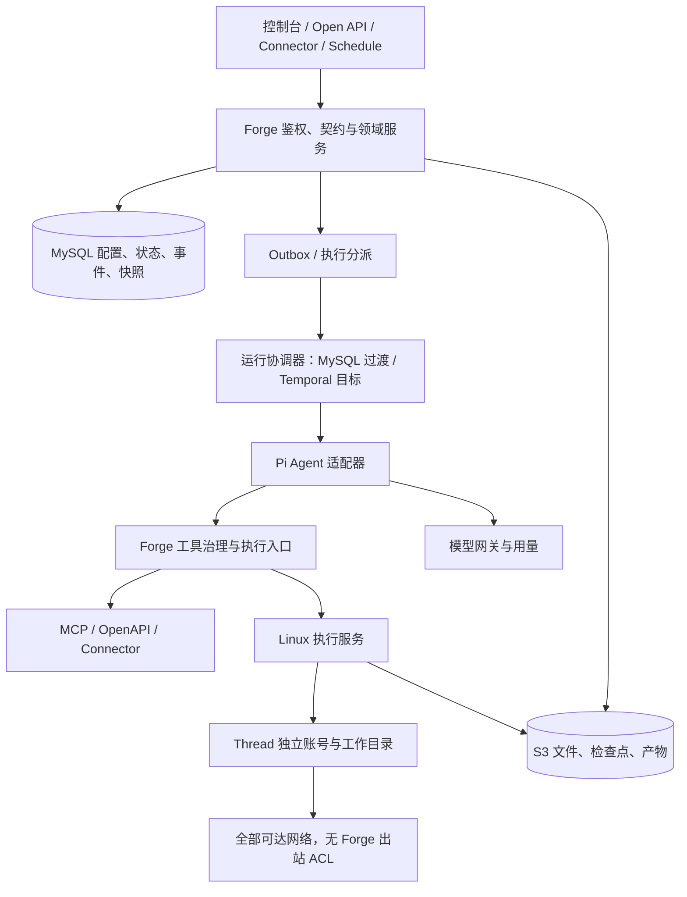

# Forge 功能补齐与通用 Agent 执行环境方案

版本：1.1　日期：2026-10-31　代码基线：`3cde87d`

状态：**READY FOR IMPLEMENTATION（E1–E3 核心开发及 Connector 适配机制就绪；后续专项与目标服务器验收按批次完成）**。本文记录补充设计；后续用户已授权继续开发，逐项实现与验证见[开发进度](2026-10-31-forge-development-progress.md)。目标设计本身不表示功能已实现，也不授权生产迁移、真实外部调用或生产发布。

## 1. 目标、决定与阅读顺序

目标是把当前可运行 MVP 补齐为需求可验收的企业 Agent 框架，并增加用户明确要求的通用执行环境。保留已有审批、预算、权限、幂等、租约恢复、SSO 和审计能力。

本轮已确认：

1. 使用 **Pi 作为 Agent 底座**，不能只添加依赖或只替换模型 HTTP 客户端。
2. Skill 支持携带和执行脚本；Agent 可以临时编写代码、安装依赖、处理文件。执行方式已进一步确认：**专用 Linux 执行服务器，只放执行器和会话文件；不引入 Docker/gVisor/虚拟机沙盒**。
3. **执行环境不设置网络权限控制**：不限制目标域名、IP、端口、公网或内网，也不对联网另设白名单审批。基础设施本身是否有路由、DNS、认证和防火墙，不由 Forge 保证或自动修改。
4. **同一 Thread 保留工作文件，空闲时释放计算资源，后续可恢复**。恢复对象是文件与运行环境配置，不承诺恢复任意进程内存、TCP 连接或后台服务。
5. 本次是完整补充优化方案，不开发业务功能。

配套文档：

- [E0 技术准入实测](2026-10-31-forge-e0-admission.md)：Pi/Connector 可复现实验、部署规格与适配边界。
- [需求覆盖矩阵](2026-10-31-forge-requirement-matrix.md)：原有 196 项功能需求、18 项非功能需求，以及本轮新增执行需求的归属、批次与验收。
- [数据补充设计](2026-10-31-forge-data-design.md)：新增/扩展对象、字段、约束、迁移和恢复。
- [接口与交互补充设计](2026-10-31-forge-interface-design.md)：对外兼容、内部执行协议、状态与页面交互。
- 现有权威契约仍为 [需求](../docs/01-requirements/product-requirements.md)、[架构](../docs/02-architecture/system-design.md)、[权限](../docs/02-architecture/permissions.md)、[接口](../docs/03-api/admin-api.md)、[数据](../docs/04-data/mysql-design.md)、[发布](../docs/06-operations/release-process.md)。本文中的建议须在对应批次开工前同步为这些契约的正式修订；不把建议写成已获用户确认。

## 2. 现状证据与缺口分类

首次核对3cde87d时工作区干净；E0开始时保留本对话已有文档改动。前轮同一提交的 `pnpm typecheck` 通过；本轮未重跑业务测试、未读取线上数据库、未验收生产服务。数据库现状依据仓库 schema/迁移，不冒充部署元数据。

| 证据 | 可成立的结论 | 不能推出的结论 |
| --- | --- | --- |
| [package.json](../package.json)、[loop.ts](../packages/runtime/src/loop.ts) | 自有循环 + MySQL 队列；没有 Pi/Temporal/Redis 依赖 | 已实现目标运行时 |
| [context.ts](../packages/runtime/src/context.ts)、[Skill Repository](../packages/store/src/repositories/capabilities.ts) | Skill 按 key 读取当前发布 Markdown 并拼入提示词 | 支持资源目录、脚本、依赖冻结 |
| [工具解析](../packages/capabilities/src/index.ts) | builtin、HTTP MCP、简化 OpenAPI 可调用 | stdio、Connector、完整 OpenAPI、安全代码执行均可用 |
| [tools.ts](../packages/runtime/src/tools.ts) | 有审批、并行上限、幂等标识、副作用中断确认 | 任意外部副作用可以自动精确重放 |
| [权限类型](../packages/core/src/index.ts)、[governance](../packages/governance/src/index.ts) | 固定角色、部分组织/主体范围可用 | 完整动态角色、deny 策略和统一 SQL 过滤已经实现 |
| [开放平台](../apps/api/src/routes/open.ts)、[应用管理](../apps/api/src/routes/admin/apps.ts) | Run、SSE、同步等待、Key 创建可用 | 完整契约、文件、Key 生命周期、分布式配额已完成 |
| [定时运行](../packages/runtime/src/schedules.ts) | Cron、时区、服务账号与 skip 有实现 | Temporal Schedule、queue、cancel_previous、固定版本已完成 |
| [实现状态](../docs/05-development/implementation-status.md) | 记录历史测试和已知限制 | 历史用例数量等于需求完成率 |

分类规则：已有能力纳入回归；部分实现按验收细项补齐；尚未实现纳入对应交付批次；原 P1/P2 不假装属于已承诺首版。矩阵覆盖范围不等于逐项当前行为已完成实测。

## 3. 技术选择与职责边界

### 3.1 推荐基线

| 能力 | 本方案选择 | 理由与实施约束 |
| --- | --- | --- |
| Agent | Pi `1.4.0` 固定版本作为机制验证候选 | 官方稳定版本；支持 Agent 循环、工具 hooks、异步事件订阅、Skill 加载。原文档 `1.3.x` 需正式修订后才能引入 |
| Pi 包 | `@earendil-works/pi-agent-core`、`pi-ai`；Skill loader 使用同版本 `pi-coding-agent` 的公开导出 | 只在 `packages/core/src/pi/` import；不启动 CLI，不自动扫描主机用户目录，不加载用户上传的宿主扩展 |
| 工作流 | 先保持 MySQL 执行器，后切 Temporal | Pi 与持久化编排分开验收；旧 Run 固定旧引擎直到结束，最终 P0 仍按 Temporal 目标验收 |
| 系统数据 | MySQL 8.0.30+；现有 mysql2 Repository 逐步增强 | SQL 留在 store；不在 Pi/执行器引入第二业务数据库 |
| 对象数据 | S3 兼容存储，开发/单机用 MinIO | 文件、Skill 包、工作目录检查点、Artifact、大工具结果共用对象存储与权限元数据 |
| 原生执行 | 专用 Linux 服务器 + systemd + workspace 独立 Unix 账号 | Python、Node、Shell；账号/目录权限、资源限额、固定运行环境和受认证管理入口。无需容器/K8s，不在 API/数据库服务器上执行 |
| 缓存/限流 | Redis 在分布式限流批次引入 | MySQL 保存配额账本和状态；Redis 丢失不应放大持久配额或丢历史 |
| 前端 | 沿用现有 React/Vite/shadcn/Tailwind/TanStack | 每个业务域完成后替换旧页面；不再同时实现 Ant Design 界面 |
| 工程 | 初期沿用 Node 22.23.3/ESLint；Node 24 兼容单列验收 | Pi 候选要求 Node >=22.19，当前可满足；Node 24 在完整 P0 交付前验证并升级，不与首个 Pi 试验捆绑 |

E0 工程边界确定：沿用现有 ESLint/shadcn；Pi 固定 1.4.0；Node24 在 E6 验收。E1 新表按项目约定补 Drizzle schema 与迁移 SQL，现有 mysql2 参数化 SQL 保留，所有 SQL 仍在 store；迁移继续只有一个执行入口，不同时运行两个建表系统。无需为 Pi 接入批量重写现有 Repository。

### 3.2 目标架构

- MySQL 是资源/权限/Run 业务事实源；Pi 内存状态是当前执行过程，不能代替数据库。
- Temporal 管等待、重试、定时与编排；Pi 决定 Agent 对话/工具轮次；外部 I/O 全在 Activity 或执行服务，不放进确定性 Workflow。
- 专用 Linux 执行服务只接收内部认证请求；Pi 和供应商调用留在 Forge Worker，执行服务器不持有 Forge 数据库、SSO、模型供应商或 Connector 管理凭据。管理服务凭据只在脚本账号不可读的位置保存，不限制脚本出站目标。
- `core` 中 Pi 适配器通过回调接入领域服务，不能反向 import store/governance，避免循环依赖。
- 外部业务操作的认证/授权仍由 Forge 工具入口或目标系统实施；网络开放不是目标系统授权，也不承诺阻止脚本访问目标系统暴露的无鉴权接口。

## 4. W01：契约、身份治理与公共基础

### 4.1 契约与错误

- 建立 `packages/contracts`，将现有 route schemas 逐域迁入并保持请求/响应兼容；管理、开放、集成、SSE、Webhook 共用 DTO 源。
- OpenAPI 3.1 必须包含参数、请求体、成功/失败响应、认证、分页和例子；生成 SDK client，CI 检查生成差异。
- 错误码注册表定义 meaning/userMessage/remedy/httpStatus/retryable/audience，类型推导封闭 code 集合；保留当前错误码含义，新增码先登记。响应补 `remedy`，不删除现有字段。
- `revision` 从 1 开始，更新以 `WHERE id=? AND revision=?` 完成；冲突 409。新控制台强制 If-Match；旧界面未迁移期间使用显式兼容入口并记录覆盖风险，完整验收前关闭兼容写入。
- Run/审计等长列表使用稳定游标，不把前端对前 200 条分页当全量分页；统一 UTC 时间过滤与结果脱敏。

### 4.2 功能与数据权限

- 落实已有设计的 roles/permissions/role_permissions/role_bindings/groups/group_members/data_scopes/data_policies/principal_data_grants，保留内置角色作为种子模板。
- 有效数据范围为 `(本地 allow 并集 - deny 并集) ∩ 外部范围`；没有 allow 默认拒绝。组织管理员只能授予自身有效权限与范围。
- Repository list/find/export/download 必须接 AccessContext/QueryFilter，在 SQL 过滤；详情、消息、工具结果、SSE、文件、工作目录、产物均重新鉴权。
- 新资源 workspace 归属 Thread；execution 归属 Run；服务账号、API App 不借用创建者权限。审计者可有元数据查看权而无正文读取权。
- 快照冻结配置和权限上限；执行时再与当前主体状态、当前授权取交集。撤权立即收紧，新增授权不自动扩大正在运行的 Run。
- 前端权限 Gate 只负责呈现；测试台、调试 Run、后台调度与导出不得绕过同一服务端治理入口。
- 当前 MySQL 会话在 E1–E4 保留；E5 按原目标切 Redis 会话，用户/角色状态仍由 MySQL 实时校验。推荐切换窗口让旧会话统一失效并要求重新登录，避免双写会话和撤销状态分叉；OIDC 在途 state 在旧 TTL 窗口内仍由 MySQL 验证。该登录影响必须写入升级说明，不能悄悄丢会话。

### 4.3 凭据与 API Key

- Key 创建可设有效期；吊销立即生效且幂等；轮换创建新 Key，默认同时吊销旧 Key，管理员可显式指定有限重叠窗口，原值只返回一次。
- secrets/secret_versions 管密文、作用域、版本、引用和轮换。以 key_version 选择解密密钥；轮换期间先双读、后重加密、校验完成后才移除旧密钥。
- MCP/OpenAPI/Provider/Connector 只存受控 secretRef，执行前校验作用域；旧 headers 中敏感值通过迁移进入凭据库，迁移报告不输出明文。
- 整个 Forge 的 `.env`、宿主环境变量和数据库凭据不得透传脚本执行环境。Agent 所需业务凭据只能由显式授权的能力获得，不承诺向已获凭据的脚本隐藏其值。

## 5. W02：Pi 接入、Skill 与不可变运行快照

### 5.1 Pi 适配契约

Forge 暴露自有 `AgentDriver` 接口，输入为 RunId、完整版本化消息、快照、工具定义、AbortSignal 及持久化/治理回调；输出为 `completed | yielded | failed` 和数据库引用。Pi 类型不越过 `core/src/pi/`。

- 使用 Pi Agent 类驱动真实模型/工具轮次；`pi-ai` 承担供应商协议，Forge 模型网关处理路由、预算、凭据与限流。
- 显式设置工具和 Skill 路径；禁用宿主默认 bash/read/write/edit、默认目录扫描、项目扩展、插件自动安装。自定义工具把代码/文件操作送到原生执行服务。
- 保存 Pi 原生完整消息结构的版本化内部载荷，包括工具 ID、分块、多模态及供应商恢复需要的签名；对外继续返回 Forge DTO。不能通过纯文本转换丢掉推理/工具协议所需字段；受限载荷加密存储且不进入普通审计/UI。
- Skill 仅将名称、描述和只读路径注入目录，按需读取正文；显式绑定/调用可强制加载。frontmatter 的 allowed-tools 是声明，不是授权来源。

### 5.2 审批与恢复必须解决的机制

已核实 Pi 1.4.0 的 `Agent.subscribe` 会等待异步监听器，工具 preflight 发生在 assistant message_end 之后；`beforeToolCall` 可以阻止执行，但会生成错误工具结果；单个 `terminate:true` 不保证混合批次停止，只有整个批次均设置才自动停止。

因此适配规则固定为：

1. assistant message_end 回调先在事务中落库模型消息、用量和整批 tool_calls；提交失败不得执行任何工具。
2. 每个工具调用先校验快照、当前权限、状态和参数。需要审批时创建 pending_approval，适配器临时阻止 Pi 调用，但**不把“待审批”伪结果作为最终 tool message 保存**。
3. 同批无须审批的调用可以完成并各自保存结果；存在任一挂起时，`finishTurn` 显式返回 end，绝不让 Pi 继续模型轮次。
4. 协调器持久等待并释放进程内 Pi 实例。用户决定审批的事务先写决定和 Outbox，成功响应不依赖同步执行后续 Run。
5. 恢复时由 `runToolCall` 等同一适配入口执行未完成调用；已经成功的结果读回复用；拒绝/过期生成真实拒绝结果。所有工具结果齐备后，从数据库规范消息重建 Pi，调用 continue。
6. 每个工具 key 为 `runId:toolCallRowId`，供应商 toolCallId 只作协议关联；并行结果按原调用顺序重建上下文。
7. 普通工具异常可以交还模型；持久化失败、租约丢失和执行所有权不确定必须终止当前 driver，不能被 Pi 归一化成普通工具失败后继续。适配器设置全局 fatal 标记、abort，并在每次副作用前复核 fence；E0 验证这种组合真实成立。

该组合已由 E0 的真实 Pi 1.4.0 隔离实验验证：混合批次挂起、异步持久化屏障、规范历史恢复、不重复已完成工具、持久化异常阻断副作用及 fatal+abort 停止后续模型请求均通过。见 [E0 实测](2026-10-31-forge-e0-admission.md)。这足以进入 driver 开发，不代替真实 MySQL/审批 HTTP/Temporal 的后续集成验收。

### 5.3 发布与快照

- 保存草稿允许暂时缺失依赖，但返回可定位诊断；发布必须校验输入/输出 Schema、模型能力、所有依赖、脚本资源、凭据引用、作用域、预算、审批和执行环境兼容性。
- 发布版本不可原地编辑；回滚创建/激活可追溯版本，不改变已运行 Run。
- 创建 Run 事务内写 Agent 版本、Skill 版本及 checksum、工具/Provider/Route 配置副本或不可变版本引用、预算/审批/权限上限、执行环境 profile/fingerprint、运行引擎。
- secretRef 冻结凭据资源身份和作用域；不把明文凭据写快照。普通密钥轮换使用该资源当前有效密文版本，撤销须拒绝；不能为重放继续使用被撤销的秘密。
- 旧 Run 没有完整快照，继续由 legacy 引擎处理并标记 snapshotQuality=legacy；不得事后用当前配置伪造历史冻结结果。

### 5.4 Skill 资源与依赖

- 保留现有 Markdown Skill，导出时生成标准 SKILL.md；新增目录包包含 scripts/references/assets，安装与发布只校验/保存，不执行脚本或安装钩子。
- 校验 frontmatter、引用文件、路径穿越、大小、checksum、脚本运行环境和依赖清单。普通文本 Skill 无脚本也可运行，无需创建执行进程。
- 运行时将固定版本 Skill 资源发布为 root 所有、脚本账号只读的目录；会话工作目录及用户依赖位置可写。Python venv、Node 包安装和构建均在对应会话账号下执行，记录实际版本与日志。
- 模型在运行时新安装的包不能声称已在Run创建时冻结；安装请求/lockfile及实际解析版本写执行记录与检查点，重复恢复使用已保存字节而不重新解析latest。同一Run中再次安装属于显式工具副作用；声明式Skill/模型/工具版本仍不可漂移。
- 系统级包由运维配置执行机 runtime profile；脚本账号无 sudo/root 权限。需要二进制的 Skill 发布时检查解释器/ABI/依赖兼容，不在 Worker 临时安装。
- 禁用阻止新 Run 选用；紧急撤销阻止进行中的后续执行。普通版本升级只影响新 Run。

## 6. W03：专用 Linux 原生执行与会话工作目录

### 6.1 部署及权限

用户已选择专用Linux服务器，只部署执行服务和会话文件。不引入Docker、gVisor或VM；不把同账号直接执行描述为多会话安全隔离。Pi Agent继续运行在Forge Worker，通过受认证的内部执行协议调用该服务器。

首版支持单执行主机，不做自动跨主机热迁移；目标安装基线为Linux、systemd>=255、cgroup v2、Node>=22.19（随Forge版本锁定）、已登记Python/Node运行环境、支持用户配额的工作数据盘。版本/功能由部署preflight实查，不满足则提示缺项，不以无约束执行回退。

- 每workspace绑定一个稳定、不可登录、无sudo的Unix UID/GID，不能让多个workspace共用账号；目录`/srv/forge/workspaces/<workspaceId>`为0700，默认UMask=0077。UID在工作文件存在期间不复用。
- 每次exec使用独立systemd service和cgroup，名称由executionId生成。不同命令同一workspace仍按Run顺序串行，不保留脱离管理的后台进程。
- 可信broker负责账号、systemd单元和文件管理；脚本账号不能调用其特权操作。broker只接受签名的固定操作和ULID，路径由服务端映射；不用模型提供的用户名/宿主路径拼sudo或shell命令。
- 脚本内容存root管理、仅对应workspace账号可读的指令文件；通过argv启动固定解释器，不将用户命令拼接为broker shell，也不把包含秘密的脚本正文放在管理进程命令行。
- systemd固定User/Group/WorkingDirectory、UMask=0077、NoNewPrivileges=yes、CapabilityBoundingSet空、ProtectSystem=strict及仅workspace可写。脚本无cron/at/用户systemd持久任务权限，不能绕过进程生命周期。
- 执行服务管理票据不可进入脚本环境；不复制Forge `.env`、供应商Key、SSO/数据库/Connector秘密到执行服务器。Linux账号及普通文件权限不是对宿主内核漏洞的隔离保证。

### 6.2 网络与资源

不增加域名/IP/端口、公网/内网ACL或联网审批，不设置PrivateNetwork/IPAddressDeny等网络限制。目标服务的认证以及公司网络实际可达性不由Forge替代。

默认CPUQuota=200%、MemoryMax=2GiB、TasksMax=256、命令RuntimeMaxSec=300（模板可配至1800）、TimeoutStopSec=5、KillMode=control-group、SendSIGKILL=yes、Restart=no。工作盘启用每UID硬配额10GiB及inode上限；不能用du定期扫描冒充硬配额。磁盘配额或控制器缺失时preflight明确失败，不能宣称相应硬上限已生效。

exec默认high risk，沿用审批；可由有策略管理权限的人显式豁免，不增加命令白名单。stdout/stderr各64KiB内联、各10MiB完整日志上限，超过后继续排空管道并丢弃超量字节，标truncated，防止反压卡住进程。

### 6.3 持久文件及运行环境

workspace状态仍采用provisioning/ready/busy/suspending/suspended/restoring/recovery_required/deleting/deleted。空闲15分钟回收常驻会话进程、文件句柄和缓存；命令service结束时已释放其进程和cgroup，不为保留文件维持空转Pi进程。

1. 每个Thread一个workspace；同一workspace只允许一个活动写入Run（含等待审批）；其他Run FIFO排队。普通对话不分配执行账号。
2. HOME、venv、node_modules和工作文件留在该workspace，系统解释器安装在root管理、不可由脚本修改的版本目录。runtime profile记录解释器准确版本/路径、架构、ABI/系统兼容信息和依赖清单fingerprint，不使用imageDigest。用户级依赖及其lockfile/checksum由workspace检查点记录，不混入只读解释器profile。
3. 每次非只读操作结束，先确认所属cgroup为空，再生成内容寻址检查点和manifest并CAS提交；成功工具结果必须对应已提交检查点。文件复制前后不允许该UID仍有后台写入者。
4. idle只释放计算，不卸载/删除工作盘。检查点归档失败保留原文件，返回“执行已发生、持久化未确认”，禁止自动重跑副作用。
5. 后续用同一UID、路径与runtime profile继续；备份恢复复制数据到相同路径并校验checksum。符号链接按链接本身保存，不由broker在宿主跟随；安全解析在脚本账号下实施，其他workspace目录0700拒绝越权。上传Skill包仍拒绝链接。
6. profile不兼容时拒绝恢复并给出迁移操作，不能静默改用最新Node/Python。此模式不承诺还原任意内核/系统镜像或进程内存。旧runtime目录在被引用期间保留；OS升级须验证已引用profile兼容性。
7. 未设保留期不自动删除会话文件；删除或显式保留策略在引用归零后清理。运行中上传先入文件库，在下一个安全点导入；UI只读已提交checkpoint。

### 6.4 所有权、取消与异常

- executionId同键同体查询同一任务，同键异体409；执行意图先持久化，再调用broker。服务进程重启后通过本地原子意图文件、systemd unit和bootId对账，不引入第二业务数据库。
- fenceToken仍是单调所有权代次。新代次只能在旧cgroup确认空后启动；kill shell父PID或进程组不够，setsid子进程仍必须由cgroup收尾。
- 用户取消或超时，systemctl stop先TERM、5秒后KILL整个cgroup，检查停止结果后才结束Run；进程处于不可中断状态时继续“停止确认中”，不能伪cancelled。
- 本机重启后bootId变化、旧进程已消失，但外部副作用可能已发生；完成结果有账本则复用，未知写操作保持中断确认，不因进程消失就重跑。
- 主机失联时不把目录备份自动迁到第二台机器执行。先恢复原机，或经运维确认关机/隔离旧机后做灾难恢复；未确认停止就保持recovery_required。
- 签名票据、账号/路径映射、systemd运行参数和日志读取均是管理面，不能把特权broker当成公开任意shell服务。

## 7. W04：文件、文档与产物

- 上传经过主体/配额/类型/大小检查；字节进私有对象存储，MySQL 保存归属、checksum、状态及引用。未完成上传不可被 Agent 使用。
- Thread/Run 引用文件时重新验权；禁止模型传入任意 storageKey 直接读取。下载经权限校验生成短期 URL，失效后重新鉴权；敏感场景可走 API 流式下载。
- Artifact 必须有已成功上传的对象、Run 关联和 checksum 后才能 ready；命令成功但产物归档失败时不能宣称“文件可下载”，应保留部分结果并提供重试归档。
- 大工具结果保留原始对象和摘要引用；上下文、SSE、日志不塞完整二进制或巨大正文。下载日志仍需脱敏与访问控制。
- PDF/Word/Excel/PPT/图片解析走独立 MCP 服务；先做版本化解析契约，失败有固定错误码、可重试状态，不能把空文本当成功。
- 图片通过模型能力预检，保留原图引用和压缩图关系；输入/输出 Schema 在服务端校验。
- 删除规则区分用户文件、Skill 资源、workspace 检查点、Artifact；共享 blob 只有引用归零且保留期满足才物理回收。

## 8. W05：模型、工具、MCP、Connector 与能力包

### 8.1 模型

- Pi 内置协议适配 OpenAI/Anthropic/Google/Azure；OpenAI-compatible 保持现有调用路径兼容；供应商不支持能力时发布/运行拒绝或使用已声明 fallback。
- 自动发现仅生成待确认模型目录，不自动更改已发布 Agent；连接测试、模型测试、路由测试统一脱敏和预算。
- Route 条件按能力、上下文、组织匹配后选候选；固定顺序和不可变快照。不得把 fallback 当成无条件换到未授权供应商。
- Provider RPM/TPM/并发用 Redis 原子预占；Run/用户/组织/应用周期配额在 MySQL 账本预占与结算。模型调用前预算不足不调用，调用后超限停止后续调用并保留输出；价格未知默认拒绝成本受限运行，管理员可明确设置价格后发布。
- 可重试模型错误指数退避并加抖动，优先尊重有上界的 Retry-After；超出整体 deadline 停止。非幂等工具不因 5xx 自动再次提交，先查结果或按中断确认流程。

### 8.2 工具与 MCP

- OpenAPI 解析保存参数 in/location、required、style/explode、requestBody media type、security 和引用解析结果；不再把 POST 的 query/header 参数误塞 JSON body。
- URL/文件/文本导入先预检，再选择操作；冲突、外部引用、循环引用及不支持的编码明确报错，不能静默丢字段。
- 工具可独立测试、启停、覆盖名称/描述/风险；测试也生成受审计调试 Run，高危调用执行前审批。
- MCP HTTP 保留；stdio 进程由独立执行服务管理，提供命令模板、凭据注入、资源限制、退避重启和退出回收。该管理模板限制的是受信服务启动，不限制通用原生exec 的命令。
- 发现刷新不得覆盖管理员风险/启停策略；上游移除标失效并提示引用方；未批准的新工具不自动进入 Agent 白名单。
- MCP OAuth/Resources/Prompts/旧 SSE 按 P1；旧 SSE 默认关闭，支持状况在测试台明确展示。

### 8.3 Connector

- 仅接入经过 SHA256 校验的内部 0.2.0 制品；本机已找到0.2.0内部开发包并重新核验Node/Python制品hash与大小，正式Node包名为 @leadong/agent-connector；引入位置与实包接口见E0实测，禁止使用公共同名包代替。
- 完成配置验签、版本单调、实例隔离 LKG、心跳、撤销与失败关闭、callSystem、grant/path/capability/dataScope 检查。
- 入站仅 `/integration/v1`，清除自报身份头、路径规范化和外部范围交集继续生效。出站不保存目标系统密钥。
- 0.2.0数据范围来自已验签配置中选中的call policy（dataScopeType/dataScope），不是normalized Principal或callSystem的额外参数。Forge在SDK验签/路径授权后校验并执行该范围，与本地范围取交集；出站工具按已登记参数/数据域映射收紧请求，目标系统仍需执行自身已验签入站策略。缺失、未知类型或未登记映射失败关闭；不伪造身份头。详见E0实测中的明确规则。
- Mock 只能用于本地协议验收；生产登录/入站/出站各自有真实联调闸门，缺任一项不开放对应能力。

### 8.4 包生命周期

- 实现 `.forgepkg`、manifest/checksum、大小/文件数/路径校验、依赖版本、作用域与预检；脚本只作为 Skill 资源存入，安装过程不执行。
- 安装写 staging 资源，全部校验完成后事务切换活动版本；外部探测在事务外，失败补偿仅针对本次创建资源，不回滚其他人的更新。
- 升级/回滚只切换新 Run 可见版本；旧版本在被运行/Agent/workspace 引用期间保留。
- 卸载先检查已发布 Agent 与活动 Run 引用，禁止直接删除；提供引用迁移/排空流程。
- 工具包、Provider、Skill 和 Agent 导出均去掉明文凭据，以 secret 参数占位和依赖清单表达。包签名与 CLI 按 P1 实现。

## 9. W06：Temporal、调度、开放平台与可靠事件

### 9.1 持久化编排切换

- 创建 Run 事务同时写快照和 outbox；Dispatcher 使用固定 workflowId=`run-<id>` 启动 Temporal，重复派发不重复启动。
- Workflow 只携带 Run/消息/快照/操作引用；Pi 驱动发生在 Activity 内。Activity 到安全暂停点可返回引用，审批使用 Workflow Signal 等待。
- 每个模型/工具步骤使用数据库意图与完成记录；Activity 重试先查完成状态，未知副作用按 W03 规则处理。
- 新 Run 写 `runtime_engine=temporal-pi`，旧 Run 留在 mysql-legacy/mysql-pi；旧 worker 只认领自身支持的引擎。切换失败只停止新引擎接单，不能让旧 worker 接管新引擎 Run。
- Thread 开始使用新顺序/工作目录机制前，必须确认该 Thread 的所有旧引擎活动 Run 已结束；历史存在多个并行 Run 时等待全部排空，不任意挑一个填 active_run_id。过渡期禁止让会忽略新引擎字段的旧二进制继续无限领任务。
- Schedule 同样拥有唯一调度引擎。迁移先停旧触发、确认在途、创建停用 Temporal Schedule、校验 next occurrence、切换归属再启用；以 scheduleId+计划触发时间去重。

### 9.2 定时任务

- skip：有活动 Run 则记录 skipped；queue：按计划触发时间 FIFO，设置有限积压并在溢出时记错误；cancel_previous：等待前一 Run 确认停止后再启动，超时不并行写同一 workspace。
- 版本策略明确 published-at-trigger / fixed-version；触发时复制当时版本到 Run，执行过程中不漂移。
- 服务账号、Agent 或授权失效即暂停；历史显示计划时间、实际触发、Run、跳过原因、错误及重试次数。
- 失败阈值与通知规则由系统设置管理；P0 至少交付控制台可见告警及一个可配置外部通知渠道；P1 扩展完整通知中心与补跑窗口。

### 9.3 开放平台

- 补齐应用/Key 生命周期、输入输出 Schema 目录、完整分页、文件/Artifact、调用日志、分布式配额；保持 `/open/v1` 既有字段语义。
- Webhook endpoint 可选择事件，连续失败达到配置阈值自动停用 endpoint（不必停整个应用），有重新启用与重放入口；事件与业务终态经同事务 Outbox 发布。
- Run retry 创建新 Run 并保存 retryOfRunId；默认固定原 Agent/依赖快照但使用当前授权交集。使用最新版本应为另一个明确操作，不能偷偷替换。
- Thread 内部管理在 P0 补齐；外部 Thread API/运行中插话仍按原 P1 实现，但文件持久化模型现在就按 Thread 设计。
- SSE 保留事件续传。完整 P0 的 token 增量需求暂不标完成：先实现不会泄露跨分块敏感值的验证方案，未通过前保持完整消息事件；不能通过删除脱敏恢复 delta。

## 10. W07：控制台、交互与观测

沿用当前组件和视觉，不另起 UI 技术栈。新页面用生成的 client；先完成一个业务域的前后端、权限与验收，再把旧入口切过去。

| 页面组 | 补齐动作 | 必须走通的用户任务 |
| --- | --- | --- |
| Agent/Skill/包 | 草稿、校验、版本、复制、导入导出、资源文件、绑定、发布/回滚、引用迁移 | 构建者交付可运行且可重复编辑的 Agent |
| 会话与运行 | 历史分页/筛选、工作文件、执行日志、产物、用量、取消、失败重试 | 多轮处理同一文件，回收计算后继续，下载实际产物 |
| 执行环境 | 模板、环境版本、资源上限、工作目录状态、恢复/清理 | 管理员定位卡住的执行，不靠手工改库恢复 |
| 模型/工具/MCP | 发现、参数/鉴权、测试台、风险、健康、引用 | 接入一个真实外部能力并在 Agent 中使用 |
| 应用/Key/Webhook | 有效期、吊销、轮换、Scope、配额、事件、失败重放 | 外部应用安全上线、轮换凭据且可诊断失败 |
| 组织/角色/策略/凭据 | 组织树、多角色/组、矩阵、deny、预览、secret 引用/轮换 | 管理员收敛权限且不能给自己提权 |
| 审批/定时/SSO | 审批竞态、暂停恢复、版本与并发策略、Connector 生命周期 | 审批协作与服务账号定时执行 |
| 总览/审计/设置 | 成功率、P95、用量成本、队列/执行器、变更历史、保留策略 | 通过 runId 从 UI 定位执行、审计与产物 |

交互统一覆盖加载、空、错误、无权限、冲突、提交中、恢复中、部分结果；失败保留草稿，取消显示请求中与已停止的区别。页面只放任务所需信息，不铺技术说明；技术字段放开发文档。长文本、中文、键盘焦点与屏幕阅读名称按现有设计系统验收。

日志/Trace/指标关联 requestId/runId/threadId/toolCallId/executionId；运行日志与敏感原文分开。补齐模型/工具/执行器 spans、队列积压、审批等待、工作目录空间、回收/恢复失败、Webhook 停用、Connector 漂移。指标标签不使用无限增长的 RunId。

## 11. W08：P1 / P2 的完整保留范围

P1 分成五组，均沿用前述权限、文件和执行入口，不另建绕过治理的链路：

1. Agent/会话：Prompt 变量、片段、插话、灰度、外部 Thread API、长任务回调、Run 重放调试。
2. 知识库/评测：导入解析分块、MySQL 小规模检索、引用与权限、版本回归、人工评分、受预算约束的定时黄金集。
3. 治理：审批会签/转交、字段脱敏、内容安全/PII、单资源共享、数据保留、包签名、组织 Provider 覆盖。
4. 集成：MCP OAuth/Resources/Prompts/旧 SSE、OAuth2 工具、入站 Webhook、补跑、插件 CLI、TS/Python SDK。
5. 运维/产品：英文、版本差异、通知中心/更多渠道、HA、Helm、离线包。

P2 保留：Agent 互调/A2A、深度/循环/预算传播、嵌入聊天组件、能力市场、自定义协议适配、OpenAI-compatible Agent 端点、MCP Gateway、长期记忆、事件总线。每组启动前需专项契约，不为了“完整方案”提前实现空壳。

这些阶段不自动包含多租户 SaaS、移动 App、计费出账或 Workflow Builder。脚本与原生执行器从原先分离的 P1/P2 提升为本次核心执行批次；其余原优先级保留。

## 12. 交付批次、依赖与退出标准

| 批次 | 范围 | 依赖 | 退出标准 |
| --- | --- | --- | --- |
| E0 方案准入 | 契约修订、Pi 机制试验、专用Linux部署契约、持久目录与systemd依据核实、Connector 制品清单 | 本方案 | 关键前提有证据，失败不会静默降级；列清技术基线决定 |
| E1 治理与数据基础 | W01、contracts、错误、revision、Key/secret、权限、快照、Thread 顺序和文件元数据 | E0 | 跨主体/deny/撤权/并发/迁移通过，现有入口无权限扩大 |
| E2 Pi 与 Skill | W02，MySQL 执行器承载 Pi，发布校验、资源版本 | E1、Pi 试验通过 | 真实 Pi 多步工具、混合审批、取消、故障恢复通过；旧 Run 不受影响 |
| E3 通用执行闭环 | W03/W04，原生执行器、持久目录、依赖安装、文件/Artifact | E1/E2、原生执行安装preflight | 同会话上传→执行→回收→恢复→产物下载，开放网络和隔离边界均验收 |
| E4 能力与开放管理 | W05、Key/Webhook/配额、模型路由、MCP/Connector、完整包 | E1，涉及脚本依赖 E3 | 合同审查等原用户旅程端到端可完成；第三方未联调能力保持关闭 |
| E5 持久工作流与调度 | W06、Temporal/Redis、会话切换、全部调度策略、可靠事件 | E2/E4 | 新旧引擎并存、迁移去重、审批等待、节点故障、会话失效及 Schedule 切换通过 |
| E6 完整 P0 交付 | 全部原 P0 + 核心执行扩展；UI 迁完对应域、观测、安装/升级/备份、Node 24 验证 | E1–E5 | 矩阵 P0 无缺项，原 9 条用户旅程和新增执行旅程通过，NFR/发布闸门有证据 |
| E7 平台化 | W08 中所有原 P1（脚本已提前） | 相关 P0 基础 | 各业务域专项验收；不以 API 存在代替用户任务完成 |
| E8 生态能力 | W08 中原 P2 | 相应 P1；明确实际场景 | 逐能力定契约与验收，禁止无场景预建 |

页面与测试随每批交付，E6 不是首次补 UI/测试。团队人数和真实环境尚不清楚，本方案不给未经估算的工期；E0 完成后按每批纵向任务拆工时。

NFR 按交付拓扑验收：单机目标在 E6，HA 目标在 E7；可用性百分比需要实际观察窗口，短期演练只证明覆盖的故障恢复，不能替代长期 SLO 达标证据。

## 13. 测试、证伪与验收证据

下表均为**待执行**，不是本轮通过记录。实现时使用既有测试 fixtures/隔离数据库；新增业务样本与真实服务调用按届时授权取得，不借设计文档扩大授权。

| CASE | 关联 | 精确断言与禁止副作用 |
| --- | --- | --- |
| C01 Pi 基本链路 | W02 | 真正进入 Pi Agent 循环完成两轮工具调用；用量/消息/事件一致，禁止用 mock 循环冒充 Pi |
| C02 混合审批 | W02 | 同批只读工具完成、高危工具挂起；不产生下一次模型请求，不把待审批存成最终错误；恢复只执行未完成项 |
| C03 崩溃窗口 | W02/W06 | 分别在模型回复前后、意图落库后、工具完成落库前中断；已完成不重跑，未知副作用转确认 |
| C04 撤权与快照 | W01/W02 | 发布新 Skill/模型不改变旧 Run；主体停用或 revoke 后下一次执行拒绝，新授权不扩大旧快照 |
| C05 会话文件恢复 | W03/W04 | 上传→运行修改→回收计算→恢复→续跑；文件checksum/内容和runtime profile一致，依赖无需重新选择最新版 |
| C06 隔离与开放网络 | W03 | 可访问测试公网和测试内网服务；Forge 无网络白名单拒绝。跨workspace、管理凭据权限拒绝；普通Linux系统文件可按OS权限读取，不承诺内核或网络隔离 |
| C07 取消/超限 | W03 | 超时、OOM、磁盘满、日志过量、fork 压力得到明确终态；进程树停止后才释放写入者，无伪 cancelled |
| C08 所有权竞争 | W03 | 重复 exec 不重复启动；旧 fence 请求拒绝；旧主机不能确认停止时不迁机启动第二写入者 |
| C09 检查点失败 | W03/W04 | 上传中断/manifest 缺失/checksum 不匹配不激活检查点，不删除唯一目录；归档失败不返回有效下载产物 |
| C10 文件权限 | W01/W04 | 其他组织/App/Thread 猜 ID、下载、列目录、SSE 均拒绝；有 Run 元数据权限不自动获得正文/文件权限 |
| C11 Key/secret | W01 | Key 过期/吊销即拒绝；轮换重叠窗口精确；旧密文用旧 key_version 解密，新写用新版本；日志无秘密 |
| C12 发布/包 | W02/W05 | 缺依赖/不支持模型/路径穿越/坏 checksum 拒绝；升级失败活动版本不变；有引用禁止卸载 |
| C13 工具协议 | W05 | OpenAPI query/header/body、security、$ref 各自正确；MCP 管理覆盖保留；高危测试同样审批 |
| C14 权限与编辑 | W01/W07 | deny 优先、防提权、跨组织、If-Match 冲突；失败不覆盖别人更新；后台任务/导出同规则 |
| C15 配额与成本 | W05/W06 | 多副本并发请求不能绕过总额度；幂等重放不重复扣费；未知价格按策略拒绝 |
| C16 Temporal 迁移 | W06 | 相同 outbox 重发只有一个 Workflow；旧 worker 不领新引擎 Run；新旧 Schedule 同时间不重复触发 |
| C17 Schedule | W06 | skip/queue/cancel_previous、固定版本、服务账号停用、DST、补触发各符合契约 |
| C18 Webhook | W06 | 选定事件才投递、签名正确、重试/停用/重放可查；消费者按 eventId 去重 |
| C19 SSE/脱敏 | W06 | 序号、续传、重连一致；跨任意分块的秘密不泄露。安全流式未通过就不打开 delta |
| C20 产品任务 | W07 | 从正常 UI 入口完成构建/安装/运行/审批/下载/定时/轮换；不靠 SQL 补数据；长文本与键盘可用 |
| C21 交付恢复 | W09 | 干净环境安装、空库迁移、旧库升级、回滚镜像、备份恢复后实际业务可读；禁止只检查备份文件存在 |
| C22 可观测/NFR | W07/W09 | 按需求原阈值测延迟/并发/权限查询；runId 串起日志、Trace、事件、用量；未测项不可标达标 |
| C23 P1/P2 | W08 | 按矩阵保留原验收条款逐域派生专项 CASE；专项契约未完成前不标该批 READY |

已有命令使用 `pnpm verify`、`pnpm build`、`pnpm smoke:isolated`、`pnpm smoke:sso`，以 package.json 为准。新增 integration/contract/e2e 命令必须在实现时真实建立后再引用。业务库不作为测试库。

## 14. W09：迁移、发布与回退

1. 以当前迁移 001–008 为基线，新增编号实施时重新确认。所有结构变更先 expand，不修改历史迁移，不在同版删旧列。
2. 先备份并验证可恢复，再迁移，再发布兼容读代码，再回填，再切写；回填按主键分批有游标、校验和、失败记录，可重复运行。
3. 权限迁移用现有角色/范围生成等价初始策略，抽样和全量权限差异检查都不得扩大授权；旧 org 表示子树的现有语义要映射为目标 org_tree，不能直接重命名后变成仅本组织。
4. Legacy Run/Skill/Key/Webhook 不伪造历史快照、签名或到期时间；旧消息保留原 seq，新增 thread_seq 后并行期双读，来源不确定的历史排序需显式标记。
5. Pi、executor、Temporal 分别设置发布开关；执行机缺所需systemd/账号/配额条件时明确不可用，不在API或数据库服务器回退执行。关开关只阻止新接单，进行中的 Run 按固定引擎排空。
6. 执行环境profile、解释器版本目录和Skill版本保留所有仍被Run/workspace引用的版本；升级必须验证旧目录恢复兼容性。
7. 回滚到兼容版本前停止新能力接单并排空/明确处置在途任务；老二进制不认识新记录时不可直接全量回滚。数据库保留扩展列，数据恢复与代码回滚分开。
8. E6 交付 Compose、K8s 模板、镜像、备份恢复脚本、操作说明和发布记录；按现有公司流程，生产只用不可变 tag/digest，libo 账号需具备 Jenkins 发布权限。
9. 实际提交/推送仅在非 Focustech 网络；堡垒机/Jenkins/线上 DB 按项目约定的网络和本机工具操作。本轮不执行这些动作。

## 15. 当前交接就绪结论

**已完成的设计工作**：统一用户确认的执行范围与网络/持久化决定；将全部原需求映射到批次；定义共享治理、版本快照、Pi 挂起恢复、执行目录持久化、接口/数据演进与验收门槛。

**E0设计准入已关闭**：真实Pi审批/恢复机制实验通过；Node/Python Connector制品核验、SDK实际API与签名策略范围来源明确；用户已选择专用Linux原生执行，取消gVisor/K8s前提；账号/目录/systemd、存储/取消/故障恢复规则已确定。E1–E3和Connector适配可以直接按规格开发。

**证据边界**：本轮没有Linux目标主机，未宣称systemd/cgroup/配额与真实服务器连通已实测；这些确定配置的安装及运行验收是部署闸门。原gVisor准入项因用户变更架构而不再适用，不记为通过。

后续P1/P2仍按各自专项契约启动；安全流式输出保留为E6专项。这里的READY只覆盖E0所验证的核心架构和指定开发范围，不意味着全部224项需求都已有可直接编码的详细规格或生产验收通过。

## 16. 官方机制依据

- [Pi v1.4.0 稳定发布](https://github.com/earendil-works/pi/releases/tag/v1.4.0)：UTC 2026-10-21，北京时间 2026-10-22；涉及 Codemode 排队与压缩修复。版本选择不依据 main 分支。
- [Pi Agent](https://github.com/earendil-works/pi/blob/v1.4.0/packages/agent/src/agent.ts)、[Agent loop](https://github.com/earendil-works/pi/blob/v1.4.0/packages/agent/src/agent-loop.ts)：异步监听器、beforeToolCall、finishTurn、混合批次终止条件。
- [Skill loader](https://github.com/earendil-works/pi/blob/v1.4.0/packages/coding-agent/src/core/skills.ts)、[Skill 文档](https://github.com/earendil-works/pi/blob/v1.4.0/packages/coding-agent/docs/skills.md)：目录/按需加载、includeDefaults 与显式路径。
- [Pi 安全边界](https://github.com/earendil-works/pi/blob/v1.4.0/packages/coding-agent/docs/security.md)：宿主账户权限与扩展执行；Pi 不自动提供完整沙盒。
- [systemd.exec 255](https://www.freedesktop.org/software/systemd/man/255/systemd.exec.html)、[资源控制](https://www.freedesktop.org/software/systemd/man/255/systemd.resource-control.html)、[停止语义](https://www.freedesktop.org/software/systemd/man/255/systemd.kill.html)：用户/工作目录、cgroup资源限制与control-group停止范围，作为原生Linux实现依据；不是本轮Linux实测。
- [Temporal Workflow](https://docs.temporal.io/workflows)、[Activity](https://docs.temporal.io/activities)：编排与非确定性 I/O 分工；幂等仍由应用完成。
