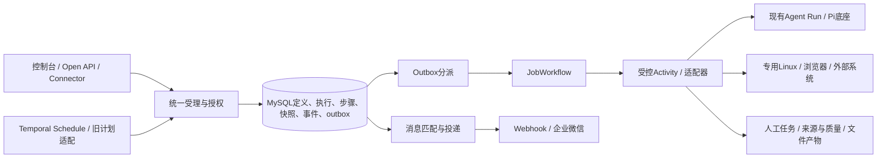

# Forge 后台优化、统一 Job 与消息管理开发设计

版本：1.0　日期：2026-11-01　状态：**READY FOR IMPLEMENTATION（本轮设计范围，按依赖切片实施）**

用户本轮授权：按推荐规则定稿，并完善详细需求、开发设计、数据库和接口设计。本文只交付设计，不修改业务代码、部署配置、迁移SQL或数据库，不发送真实消息，不提交/推送/发布。

权威组合：

| 规格 | 版本/范围 |
| --- | --- |
| [详细需求](20261101-113405-Forge后台优化与Job消息管理-详细需求文档.md) | v1.0；REQ/AC及L01–L09是产品规则来源；P01–P04/F01已由本轮定稿关闭 |
| [数据库设计](20261101-113405-Forge后台优化与Job消息管理-数据库设计文档.md) | v1.0；唯一字段字典、关系、索引、事务与迁移模型 |
| [接口设计](20261101-113405-Forge后台优化与Job消息管理-接口文档.md) | v1.0；唯一DTO/枚举、路径、消息和错误合同 |
| [既有完整补齐方案](2026-10-31-forge-completion-plan.md)、[数据](2026-10-31-forge-data-design.md)、[接口](2026-10-31-forge-interface-design.md) | 保留E1–E8；本设计细化业务任务/人工/证据/消息，替代旧目标webhook_endpoints拆分路线，不重写Pi/原生Linux执行协议 |
| [实现状态](../docs/05-development/implementation-status.md) | 区分当前MVP和目标；本增量尚未实现 |

## 1. 现状、目标与机制依据

当前是Fastify＋mysql2 Repository＋自有模型/工具循环＋MySQL worker，已有Agent版本、租约、审批、凭据库、账号/全局角色及配置CAS。没有Temporal/Redis/Pi生产实现，也没有完整File/Artifact/评测/通知交付。本次不将目标包或表名当作已有能力。

| 关键判断 | READ依据与保证边界 | 设计处理 |
| --- | --- | --- |
| 现有Run可复用，但不能直接声称Job受理原子 | createQueuedRun分别创建Thread/Run/消息；store的transaction只约束传入connection，pool级execute不自动加入事务 | 增加store原子受理/嵌套Run方法，相关写入共享同一PoolConnection；提交前不发工具/模型请求 |
| 现有租约可补充，但不是目标账号锁 | runs认领SKIP LOCKED、claimed_by与子写入fence可保护数据库；外部系统不一定认fence | 使用独立业务资源锁，未知副作用不因租约过期转让；目标不支持幂等/查询时人工核查 |
| 现有Webhook不能只挪UI | runtime/webhook按App当前URL/Secret发送；旧Repository重放重置attempts | 渠道版本冻结目标，attempt独立追加；兼容投递与App入口共用唯一服务 |
| 凭据库不能任意换消费者类型 | assertSecretScope对resource严格匹配type/id；AAD绑定Secret身份，资源JOIN/管理权限白名单固定 | 增message_channel消费者；旧App专属Secret通过精确legacy_app消费者解析，不改为平台scope、不随意复制引用 |
| 完整ULID可与旧ID共存 | core/ids已接受完整ULID和既有26位前缀ID，生成器当前截短ULID | 新对象走core完整ULID生成；旧ID及外键不重写，不新增依赖 |
| 长等待和控制可由既定Temporal承担 | 官方[消息处理](https://docs.temporal.io/develop/typescript/workflows/message-passing)支持持久condition/Signal，Signal接受不代表业务处理完成；[Workflow ID规则](https://docs.temporal.io/workflow-execution/workflowid-runid)去重受Namespace保留窗口约束 | 命令先落MySQL/outbox，HTTP202查询MySQL实际状态；业务去重持久保留，不能只依赖Temporal ID |
| Schedule重叠不能只看短受理工作流 | 官方[Schedule](https://docs.temporal.io/schedule#overlap-policy)按当前工作流是否仍打开判断Skip/BufferOne/CancelOther | 计划工作流等待本次Job执行闭合；外部未知不提前结束，防止下一周期越过未完成业务 |

以上为源码/官方文档静态核对及明确时序推演；不是新引擎、SQL迁移或浏览器的运行实测。官方资料只支持所列机制；不据此选择新的版本或宣称已验证某个SDK安装组合。

## 2. 模块与数据所有者

| 模块 | 复用及拟变更 |
| --- | --- |
| packages/contracts | 拟增jobs/job-events/messaging/evaluations DTO与JSON Schema；复用id/错误/分页约束；管理/开放/集成/SDK从同一源生成 |
| packages/core | 新ID生成出口、Job/消息枚举与注册错误/权限；不导入store/SDK/业务模型；Pi仍只在core/src/pi |
| packages/store | 拟增jobs/job-steps/job-events/human-tasks/messages/evidence/evaluations repositories；CAS、所有SQL、配额和事务原子方法；传递AccessContext和PoolConnection |
| packages/runtime | 拟增jobs/admission、planner、workflow、dispatch、reconcile、control、message-fanout/delivery；现有loop/tools/worker只接入原子终态和关联，不另写LLM循环 |
| packages/capabilities | 受信目标目录与适配器接口，注册domain/agent/skill/browser/external；保存目标版本/checksum，声明参数/资格/资源锁/结果查询能力 |
| packages/governance/identity | 复用实时主体/组织/角色、Secret、CSRF、审计；新增资源矩阵/SQL过滤/消息消费者校验，不能回退静态角色模板 |
| apps/api/routes | 拟增admin/jobs、messaging、evaluations及open/integration Job入口；旧apps/schedules写操作统一转调领域服务；controller薄，不直接SQL |
| apps/console | 拟增features/jobs/messages及扩展运行/人工/产物页面，逻辑置hooks；沿用React/Vite/shadcn/TanStack及现有Token，不引入新UI体系 |
| apps/worker、执行服务 | Temporal Worker负责新复杂Job，Linux执行仍按E3认证协议；旧worker只领本引擎Run，资源许可共享，排空策略保留 |

框架提供目标接口：`validateInput → eligibility → resources → submit → query/cancel → validateResult`，输入输出都引用已有文件/快照/attempt。资格、业务键、周期/日历、发布规则由业务适配器的DOMAIN_CODE承担；模型只负责AGENT_DECISION，不能决定权限、并发、幂等或门禁事实。

复杂Job固定`runtimeEngine=temporal-job-v1`。在E5完成前，只允许`mysql-agent-bridge`包装已有单Agent Run和旧计划，不实现第二个流程/DAG/定时引擎；桥接记录明确snapshotQuality=legacy，不能伪称完整冻结。新原生Job发布到可运行状态须满足E1快照/权限及适用E2/E3/E5能力检查。

## 3. Job受理事务与执行

### 3.1 Admission（REQ-JOB-01、AC-J01/02/08/09）

1. 按接口合同检查身份、功能/数据范围、目标可见性、参数Schema/UTF-8总量与全批项校验。HTTP幂等键不是业务键；业务适配器从可信项目/站点事实生成业务键与资源清单。
2. 外部资格取数在事务外完成，携带版本/观测时间；受理时保存证据，实际副作用前再次核验。缓存只发现候选，不作为执行授权。
3. store事务锁Job父行，确认当前发布版/显式固定版、App grant、业务对象范围和当前主体；同HTTP键已完成则在当前授权内重放；同业务键任意触发主体已有当前round则同inputHash返回已有记录（不可见时只返回通用冲突），异hash返回JOB-7103。
4. 创建execution与输入/完整依赖配置/权限上限/费用/环境快照、逻辑步骤、事件、outbox、审计、幂等响应；预算预占不得发生外部调用。commit后202。冻结Forge拥有的配置/Schema/版本，不承诺远程系统代码或实时数据不变；远端不能固定版本时snapshot_json.reproducibility=configuration_only（否则versioned_external），不改变frozen/legacy的snapshot_quality枚举，也不伪称结果可完整重放。
5. commit响应未知时返回可查询错误/同键重试建议，不发第二次独立请求；以持久化唯一记录核实。提交失败没有可消费outbox，因此无新外部副作用。

同业务键重跑必须使用显式rerun动作：新round、当前发布版与原输入、新执行ID，原记录保留；schema不兼容先拒绝，不静默转换旧输入。失败恢复则原execution/generation+1，仅重置失败项及其未完成依赖；既有成功项、模型费用、输入和依赖版本不重做。

全量失败恢复不在一个事务锁住全部展开步骤：控制事务只推进generation并追加携带选择范围的command事件/outbox；新代Workflow先按ID游标每批100条准备恢复，游标仅是可恢复的轻量Workflow参数。每批按generation/输入hash幂等更新，重复Activity无额外副作用；准备全部完成前不派发新步骤。commandId关联持久事件，重启可重读选择范围；成功项仅在输入hash仍匹配时复用，旧结果和人工编辑版本保留。

### 3.2 Temporal及步骤账本（REQ-JOB-02/03）

- Workflow ID固定`forge-job/{executionId}/g{generation}`；新建显式拒绝同ID已有/已闭合重复，已存在时查询关联后将outbox确认；超出Temporal历史保留仍以MySQL执行/事件去重，不重新启动终态任务。
- Workflow/Signal只带executionId、generation、commandId、step/attempt引用与轻量状态。正文、Prompt、模型响应、文件、凭据不进Temporal history。Activity读取MySQL快照及工具入口，Workflow不直接HTTP/SQL/随机读取当前配置。
- 主流程串行处理命令队列，Signal handler只入队ID/设置唤醒标记；异步校验/写入由主循环Activity完成，避免多个异步Signal竞争。收到Signal不代表任务已暂停或取消；UI以持久执行状态为准。
- planner根据固定manifest与已完成结果激活ready节点，条件/循环用受限确定性表达式；map按规范化itemKey建唯一明细，join只在全部依赖闭合后推进，循环不能超过maxIterations。每业务项的outcomeNodeKey唯一且位于循环外，计数只统计这个逻辑输出节点，不把每个技术步骤都计成一个业务项；上游失败不能到达输出时持久记录失败原因。单目标任务本身即输出节点。动态发现明细只允许一次只读发现后冻结列表/证据且≤1000，不能无限扩批。阶段gate的onFailure明确fail/review。
- 开始attempt事务：锁执行→步骤→有序资源锁→费用行；检查generation/state/fence、当前资格/Secret/预算，分配递增attempt_no及稳定dispatchKey，持久prepared与outbox。真正调用前再以相同锁序记录submitted/授权代次，commit后才离开进程调用目标。
- `submitted`是外部动作可能发生的边界，不声称已被目标确认。commit后崩溃，即使未实际发出网络请求，也按可能已发生处理；没有证据不能把它改回not_submitted。
- 外部副作用Activity不启用绕过账本的自动重试（maximumAttempts=1）；Workflow由账本决定继续/查询/新attempt。只读或有受验证幂等/结果查询的适配器可在L05剩余总预算内恢复；不能叠加Temporal、工具和SDK重试使次数相乘。
- 新Agent步骤事务内创建唯一Run并绑定attempt，UNIQUE(job_step_attempt_id)防重建；现有Run/工具循环按快照执行。Run终态、attempt结果、Job唤醒outbox同事务；重复Run事件只读取已结算结果，不重复计费。
- Linux/浏览器按E3code_execution稳定ID派发；资源锁归本Job执行，同时active_attempt_id保证同一执行内部也不并行写同一账号。外部结果回调必须匹配adapter/operation/requestHash/attempt，成功之后仍过结果Schema、来源与质量门禁。

### 3.3 计算许可、业务锁和预算（AC-J07/11）

协调器等待不占计算许可；物理LLM/浏览器/脚本从quota_usage_counters＋quota_reservations统一账本取得许可。每Job活动并发按实际计算计数，纯等待/暂停不占槽；计划skip仍按尚未闭合的业务执行判断。尚未启动队列最多50条，满时429不新增执行。Job等待子Agent不继续持有一份相同计算许可，避免平台2槽都被父Job占满使子Run拿不到槽。

物理许可按一次模型请求或代码/浏览器执行段持有，不按整个Agent Run持有；模型请求结束先归还相同全局槽再进入工具阶段，父Run等待子工具不占相同槽。同Job的多段活动用active_segment_count取墙钟并集，避免并行时间重复累计；许可限制的是Forge受控在途调用，不宣称第三方超时后内部计算已停止。费用未知仍保留费用预占，账号/站点副作用未知仍持业务锁。

业务资源锁与计算许可不同：纯外部等待释放计算许可，但账号/站点写入未知仍保留业务锁。worker lease到期仅使执行协调权可接管；资源锁不能按TTL直接删除。接管先查询外部执行状态，证明旧进程/写入结束才清active_attempt并移交。无法核实→waiting/reconcile，资源锁recovery_required。

费用预占锁定Job/Run/主体周期余额，`spent+reserved+按已配置价格/最大输出估算的上界≤limit`才调用。Agent、Job和App引用同一次模型请求reservation，不重复扣款；按operation_key/metric唯一键结算。用量未知保留上界预占直到对账，不立即释放后再次调用；价格缺失阻止付费目标发布/调用。实际供应商用量/价格超出配置时如实记录并停止，不承诺真实账单绝无估价差异。预算不足结束failed/BUD-5001并保留部分结果；周期配额可等待复位但仍受截止限制。

App每日次数沿用数据库UTC自然日，按外部受理入口计1（直接Run或Job），幂等重放计0；Job内部Run不重复扣调用次数，模型实际用量/费用仍逐次计量。切换只读窗口内按该App当日已有直接Run建立counter基线并记录cutoff；旧计数查询排除job_execution_id非NULL的嵌套Run，兼容版和新入口共用counter，不将旧COUNT与已包含同批Run的counter相加。

## 4. 状态、控制与人工业务任务

| 当前/条件 | 动作或观察 | 下一状态、恢复与禁止结果 |
| --- | --- | --- |
| queued，资格/许可通过 | 派发首步骤 | running；记录started；未取得许可保持queued/waiting-resource，不作伪进度 |
| running，需要审批/人工/外部结果 | 持久等待 | waiting＋原因/截止；保存checkpoint，释放计算，不重做已完成步骤 |
| queued/waiting/running | pause | 有在途动作pausing，否则paused；停止新派发；审批/回调仍可持久保存，但不越过暂停推进后续 |
| paused | resume | 重验资格/版本/预算/锁，恢复ready/等待原因；未知副作用先reconcile，不能无条件running |
| 非终态 | cancel | cancelling；没有在途/未知写入且停止被确认才cancelled；取消保留所有成功/失败明细，不把它改算partial |
| 子项仍有在途/等待/未知 | 聚合 | 不进成功终态；unknown强制waiting/reconcile，即使其它项全部成功 |
| 所有项闭合，无失败且有成功 | 聚合 | succeeded（可以有业务规则允许的skipped）；质量/客户审核gate未过则仍waiting/failed而非交付完成 |
| 所有项闭合，成功和失败都有 | 聚合 | partial；失败明细可恢复，文件可用性按对应产物ready独立判断 |
| 所有项闭合且无成功 | 聚合 | 有失败failed；全跳过skipped；已请求取消并停止cancelled |
| failed/partial，仍有可重试失败项 | retry_failed | generation+1→queued，原快照/成本上限不变，成功项复用；恢复最多3轮，旧attempt结果不推进新代次 |
| 任意等待超过截止 | timeout | 已知无副作用则failed/JOB-7107；外部未知则waiting/reconcile并标逾期，不自动释放锁或重新发送 |

控制API事务写requested_action/状态、command事件、audit/outbox；不能同步等待外部执行停止后才返回。恢复与取消竞争按同一执行锁串行：取消一旦接受，随后resume/retry拒绝，rerun需待旧写入已确认停止。状态CAS冲突返回409，页面草稿不被覆盖。

人工任务UNIQUE(step,generation)，领取/决定先锁执行与任务，校验允许动作、inputHash、处理资格与版本；结构化patch走目标Schema并生成新业务版本。领取人不自动获得审批/Job控制/产物下载权。确认外部结果必须有证据，放行保留原失败检查与理由。已处理或过期任务不重复唤醒；决定、事件和唤醒outbox同事务。

业务交付为独立delivery_status与delivery_revision。推荐生成或Run完成不自动设delivered；回读/人工观察带businessVersion及证据。工作日、服务期和催办升级规则由业务适配器提供，框架按该规则生成有稳定事件键的待办/通知，不复制小语种规则进核心。

## 5. 消息配置、匹配和发送

### 5.1 配置与权限（REQ-MSG-01/02）

渠道保存/编辑只校验并生成版本，不发送。新渠道disabled；启用、测试、重发分别授权。URL整串使用版本专用不可变Secret快照，直接值轮换该endpoint快照拒绝并引导修改渠道地址，避免旧消息因Secret引用轮换悄悄改投；主密钥重包裹不改变目标。签名/敏感Header使用当前有效Secret；只返回掩码/配置状态/fingerprint。Webhook按既有safeFetch出站策略执行，不套用Linux环境的网络开放约定。

消息规则按资源ID、事件和组织范围匹配；目标渠道可见与可用、模板范围、事件来源资格都检查。模板仅受控变量，不执行JS；业务回调保留结构化Schema，人类通知使用版本化模板。默认人类通知按Job汇总；原直接Run应用回调不自动订阅Job的所有嵌套Run。

生产者在业务状态事务中分配稳定eventId，用单条JOIN查询读取一致的规则/渠道版本/模板快照；outbox只按冻结集合fanout，配置更新不让旧事件采用新规则。同event/channel去重并记录选择；无目标不制造“已发送”。规则写以受影响eventType的settings行按名称排序先锁，再查组织含全局规则渠道数≤L06、锁配置父行，防止并发各自通过。事件快照读不反向申请这些配置写锁，避免锁环路。

### 5.2 发送事务与外部边界（REQ-MSG-03）

1. 查询到期delivery，事务锁渠道→delivery（所有编辑/取消/补发沿用此锁序），确认active、当前dispatch epoch、凭据当前有效与来源范围；目标版本变化且无明确历史目标许可则held/target_changed。
2. 原子增加total_attempts/cycle_attempts、插入prepared attempt；只在即将派发时再次锁同父行，记录授权epoch/submitted及短lease后commit。此commit是派发线性化点，外部网络不可与SQL原子提交；停用后不能取得新派发许可，已经取得许可的请求可能继续完成。
3. 事务外解密授权Secret、按冻结body生成本次签名，safeFetch带10秒超时。凭据撤销到解密前仍失败关闭；不将URL/签名/body秘密写日志。
4. 回收结果先锁delivery并校验attempt/fence，完成attempt；过期发送者只保存历史证据，不覆盖新cycle状态。Webhook2xx记delivered，已知可重试错误按L06排期；网络超时attempt标unknown，可按至少一次合同retry_wait。企业微信检查业务响应，结果未知则主状态unknown、无自动发送时间。
5. worker在submitted后崩溃：业务Webhook同event/delivery/body重试，接收方幂等；企业微信转unknown人工处理。prepared但未越过派发点可安全恢复，不把它与已submitted混淆。
6. 停用/取消阻止后续许可和重试；已授权请求回收真实结果。重新启用只作用未来，旧held不自动释放。手工重发用强ETag＋幂等创建新sendCycle，总尝试和原成功事实保留；正文已清理410。旧地址补发要求明确确认且有配置权限，仍使用原版本，不能在重发参数里夹带新URL。

配置冲突检查两个版本：渠道本身CAS；legacy渠道每次更新按App→channel顺序锁定并同步递增App revision、更新message_channel_revision。因此兼容App表单的If-Match也覆盖其读过的渠道版本；任何一路修改使另一侧旧表单冲突，不能在PATCH时才读取当前channel revision假装用户已读。sender只读兼容App消费者，不反向申请App写锁。

## 6. 定时任务及旧Webhook迁移

### 6.1 Schedule策略

新复杂Job的计划由Temporal Schedule触发 `ScheduleJobWorkflow(scheduleId,scheduledSlot)`。入口Activity按 `(scheduleId,scheduledSlot)`形成业务受理键，受理后等待本次JobWorkflow闭合；不能短工作流受理后立即结束使Overlap失效。

- skip→Skip；queue→BufferOne（一个待运行槽，多余slot跳过并可查）；cancel_previous→CancelOther，关闭旧业务工作流前必须已确认停止/已转由明确恢复任务持锁处理。禁止TerminateOther绕过副作用核查。
- 暂停中的Job仍属于在途；需要停止未来计划时同时停计划，不把暂停当完成。catchupWindow=60秒，停机积压不自动大量补跑；更早时段只能显式选择时间窗、预算及并发进行回填，沿用原FR-TR-09。
- Workflow捕获取消后进入不被普通取消打断的清理/对账段，确认停止才闭合；未知则等待核查信号。Schedule父流程也等待子Job的实际闭合，不能把SDK取消异常直接当外部已停止并提前结束。
- 服务账号、Agent、Job不可用时暂停相应计划；短暂数据库故障不伪称身份失效。触发时解析published/pinned版本并保存本次快照，旧pinned AgentVersion与新pinned JobVersion分别映射。
- 扩展schedules.scheduler_engine区分legacy/mysql-agent-bridge/temporal；两个worker绝不领取同一行。旧API入口只适配Agent型Job，复杂类型正常走Job页面，不填假的AgentID。

### 6.2 一次切换算法（REQ-MSG-04、AC-M06/10）

1. **Expand**：备份并部署“兼容版”（能识别新字段、唯一发送器入口与settings切换状态），旧mode仍只走旧管道；新Job/渠道入口暂不激活。结构迁移不触发外部操作。
2. **Quiesce**：CAS设置`job_message_cutover.phase=quiescing,epoch+1`，暂停新Job/Run业务受理、旧App回调/计划配置写（503并保留输入）、计划触发/消息派发；中央executeRun门控覆盖内嵌worker、独立worker、审批后立即执行等旁路。排空并停止所有旧派发进程及副本，登录/只读查询继续，在此窗口建立App当日次数counter基线。无法证明进程已停或请求结果可辨时不切换，不承诺零写入停顿。
3. **Backfill**：按数据库设计的固定映射/游标事务回填，pending消息保留原payload、ID、次数与下次时间；unknown在途挂起。legacy resource Secret继续精确App消费，不复制成全局凭据。
4. **Reconcile**：检查每个原配置/计划/投递唯一映射、归属/状态/Hash/授权、原已成功投递不排队、旧未完成Run可查询且其终态转入一次新fanout。停止点和摘要写settings，不输出秘密。
5. **Cutover**：CAS统一mode及epoch，逐App/计划指针写成unified/目标engine，启动兼容版/新worker；旧发送器/调度扫描SQL明确排除这些记录，状态开关不能只存在前端。
6. **Verify**：用隔离接收端验证旧事件/原签名向量、历史查询、一次入队与重试/复核，生产真实群仍需单独授权；观察积压、冲突和未知数量。失败保持暂停或回兼容版同一mode，不能同时开两套发送器。

回退只到理解新结构的兼容镜像，保留Schema/映射和Job数据；不回退不认识Job/渠道的原MVP二进制。拆列/删除旧字段延后独立版本；数据恢复必须对账外部副作用，MySQL备份回放不是“外部消息也回滚”的保证。

## 7. 数据来源、产物与效果回归

- 每来源采集保存request/response hash、取数时间、businessVersion及受控证据文件，状态ok/empty/partial/failed。适配器校验HTTP业务信封、分页覆盖和计数；不可读与缺失不写成真实零。来源请求网络配置沿工具/Connector权限，未验证响应不直接喂模型后由模型决定是否成功。
- 文档输入/中间结果/人工编辑/导出归档关联Job/Step、必要Run和业务版本，复用files/artifacts/E3对象存储。先归档校验再ready；重生前检查人工编辑版本，冲突保留旧结果；预览/下载每次查源执行/文件权限。
- 质量规则为受信Schema、事实引用完整性、明确数值/覆盖规则或人工复核；结果pass/fail/review/error分别记录，不用技术200等价业务可交付。报告画布、分类树和具体阈值仍属业务。
- 评测复用原eval_datasets/cases/runs/results；冻结数据集revision、评分规则、Agent两版本和同一输入集合，作为evaluation型Job执行，暂停/取消/费用共享。精确/Schema/区间评分由DOMAIN_CODE，生成质量由受限评测器和人工反馈；不得用自由上传评分代码。
- 自动质量检查与离线评测不同：前者可阻断本次交付，后者用于版本比较，不对已完成业务自动重跑或改写终稿。人工评分追加审核事件，再更新当前投影。
- 运营聚合分别读取执行、消息和交付事实，按组织/Job/模型统计成功/部分/未知、排队/人工等待、费用、交付逾期；不能把“通知已发送”当客户已开通。催办采用稳定业务对象＋规则版本＋工作日事件键去重，规则由适配器登记。

## 8. 权限、前端和受影响入口

新增权限目录：`job.view/manage/publish/run/control/retry`、`job_delivery.manage`、`human_task.view/decide`、`message.view/manage/test/retry`、`eval.view/manage/run/review`；文件/产物沿既定file/ artifact权限。平台管理员有全权限，其它既有角色不被seed自动追加新权限；新建模板可提供建议，由管理员在自身上限内明确授予。

数据资源job_definition/job_execution/human_task/message_channel/message_rule/message_template/message_delivery/source_snapshot/quality_check/eval_dataset/eval_run及artifact进入既定策略矩阵，allow并集减deny再与外部范围交集。execution保留创建时组织/主体，策略与主体状态实时收紧。新Repository统一SQL过滤，列表、详情、控制、SSE、导出、原文/文件下载全部校验；子对象JOIN源执行，不信任请求自报组织。

用户/服务账号在Agent步骤仍需agent.run与该Agent范围；eval.run同样不能绕过Agent调用资格。App的Job grant只允许本Job冻结声明的目标，不能获得直接Run API或任意Agent权限；服务端验证Job/attempt上下文，客户端不能伪造内部调用关联。

旧schedule/App权限保留**逐资源等价适配**：原schedule.view/manage/run只能看/操作其可见计划关联的Agent型Job子集；原apikey.view/manage只能管可见App绑定的回调子集。新Job/消息列表可以显示这些映射对象，allowedActions限定旧功能，不给一般Job发布/全局消息渠道权。兼容路径也修正数据范围过滤，不沿用任何旧全量查询作为安全承诺。

| 入口/消费者 | 覆盖与结果 |
| --- | --- |
| 新React Job/消息页面 | 使用生成client、TanStack Query与URL筛选，J01–14/M01–07；详情分步骤/明细/产物/消息，按权限独立加载；返回/刷新保留筛选，旧响应按对象ID/request generation丢弃 |
| 旧控制台应用/计划表单 | 更新为统一服务/ETag；URL只掩码且不回写，配置入口跳消息管理；旧深链接兼容跳转，不保留第二份可写配置 |
| 管理/Open/Connector手动触发、定时、评测 | 共用admission；身份/权限和幂等范围独立，后台入口不能绕过计费与业务资格 |
| Run执行/审批/取消/接管/终态 | 既有状态与API保留，增加attempt关联及事务outbox，不把Job枚举写进Run，不重复审批或结算 |
| Webhook重试/手工重放、企业微信测试 | 共用channel和投递服务，类型判定/幂等/历史目标确认一致；真实发送不在保存中发生 |
| 文件/执行器、业务回调、后台对账 | 统一attempt结果入口和证据权限；调用者不能靠写success字段推进整Job |
| SDK/文档/监控/审计 | 契约生成、兼容回归，event/delivery/request/Job/Step/Run关联；日志只外层记一次且脱敏 |

UI继承需求UI-J01～04/UI-M01～02/UI-A01；控制成功先显示受理/真实状态，SSE/查询收敛；网络恢复先读取结果，不自动重复提交。配置409保留非敏感草稿，秘密只表单内存并关闭清空；加载/空/筛选无匹配/错误/无权限/部分结果分别显示。键盘与焦点恢复/窄屏沿现有设计，技术票据/宿主路径不进入产品文案。

## 9. 实施切片、验证与反例走读

| 切片 | 依赖与实现边界 | 待实施验证 |
| --- | --- | --- |
| A1 Job基础/旧计划桥接 | contracts/错误/权限、store原子受理、Job定义/执行、旧schedule适配；原生新Job启用需冻结依赖能力，复杂流程需E5 | AC-J01/02/08/09；同键并发只一条执行/审计，旧API仍可查Run，失效服务账号失败关闭 |
| A2 消息管理与兼容迁移 | channels/versions/rules/templates/outbox/attempts、Secret消费者、App兼容、旧控制台与新页面 | AC-M01～10；HTTP响应丢失、过期表单、签名向量、未知结果/停用竞态与历史不重发 |
| B 步骤恢复/人工/执行器 | E2/E3/E5、fence/业务锁/预算、查询回收、JobWorkflow与人工工作台 | AC-J03～11、H01；重启/失租/取消/超时/同账号双分支，成功项不重复、未知不抢锁 |
| C 来源与产物 | E1快照、E3文件、来源协议/质量gate、编辑/导出版本 | AC-D01/F01/V01；缺数≠零、归档失败无下载、人工修改不覆盖、过期结果不回写 |
| D 评测与持续交付 | eval型Job、显式样本许可、统一费用、业务巡检/日历、通知规则 | AC-O01/02及FR-EV原用例；同输入A/B版本对比、费用不双扣、消息/交付/技术状态分离 |

每片包含适用的前端、API、SQL/Drizzle、contracts/OpenAPI/SDK、错误/权限/文档与向前恢复；不以“页面能打开”跳过消费者或边界。

关键反例静态推演结论：

| 场景 | 规则与确定结果 |
| --- | --- |
| admission commit已成功但响应丢失，两个入口同业务键再提交 | 唯一业务键＋Job父锁查回；同输入不新增，异输入冲突；外部动作只由持久outbox分派 |
| worker已记录submitted、尚不知目标响应就失联 | 接管不直接重发写入；query或人工核查，资源锁不因TTL转让；有幂等合同者按同operation查询/重试 |
| 两个Job都等待自己的Agent，平台只有2个计算槽 | 父协调器不占Agent计算槽，子Run按统一许可运行；没有父占槽/子抢同槽的环路 |
| 两个并行步骤写同一个账号且属于同一Job执行 | 资源锁的active_attempt_id仍互斥；“同owner_execution”不等于允许两个写者 |
| 旧attempt结果在generation+1后到达 | 保存过期证据且确认接收，不推进新步骤，不重复结算或群发 |
| 渠道修改/停用与sender开始竞争 | 同渠道父锁定义派发点；尚未授权的挂起，已授权请求保留可能完成事实；不承诺网络撤回 |
| Secret为resource=旧App，搬到channel后直接用channel身份解密 | 明确拒绝该做法；兼容channel只能委托其精确legacyApp消费者，防止扩大或失效，轮换仍生效 |
| outbox fanout已插入部分目标后崩溃 | 冻结targets＋唯一event/channel复用已存在记录，其余补齐；processed只在全部确认后，旧delivered不重排 |
| Temporal Namespace历史到期后再次收到旧start | MySQL业务/事件去重与终态检查阻止重启，不能只靠Temporal ReusePolicy |
| 旧历史消息重放且原attempt细节不可恢复 | legacy_attempts明示已知次数，不伪造细节；新尝试单增，成功旧消息不在迁移中重发 |

这些结论依据明确算法、数据库唯一/锁规则及已核对的平台机制；未对未来实现跑并发、真实MySQL迁移、Temporal Test Server或浏览器。发布校验128节点/有界循环，planner按需展开且累计≤100000步骤，越界JOB-7110并保留事实，禁止提前分配所有循环组合。实施必须将反例落为定向测试。

## 10. 验收、上线和就绪边界

本轮完成STATIC设计核对：真实调用入口/字段/Secret限制与旧接口已核实，关键事务顺序和失败终态有单一规则，相关文档链接/枚举/示例需共同校验。业务验收仍为NOT RUN：

- 结构/契约：空库与012升级/断点重跑、Schema/Drizzle一致、权限/Scope/ETag/幂等、JSON大小/Unicode边界、每个接口Schema/OpenAPI/SDK契约；真实MySQL/Temporal测试，不用SQLite替代。
- 生命周期：暂停/取消/恢复、未知写入、回调迟到、预算并发、同账号锁、消息重复/停用/改地址/未知、人工复核与过期输入。
- 正常入口：按项目ego-browser规范，从Job创建到手动/API/定时执行、批量失败恢复、人工处理、产物下载、渠道配置/测试/消息重发逐页验收，保留对象ID关联证据；不以一个代表实体代替其它入口。
- 样本：四个用户指定本地项目是场景来源；具体真实业务载荷、账号、真实模型/群/外部写操作仅在后续明确许可下使用。协议向量/故障注入可以在隔离技术测试中验证机制，不能冒充客户真实验收。目标Linux、公司SSO/Connector、真实群未获验收许可不调用。
- 验证命令沿当前有效脚本：pnpm verify、build、smoke:isolated、smoke:sso；新契约/Temporal/迁移定向测试纳入现有test，不把不存在的test:integration/test:contract称已运行。纯文档本轮不重启或发布。
- 发布继承备份/迁移审批/带SHA时间戳镜像/digest/回滚兼容镜像/SSO开关边界，真实SSO与Connector未通过不开放生产通道。首次安装和升级分别验证，停机后持久状态可恢复；保留期清理与备份恢复演练独立验收。

就绪判断：需求产品规则已由用户采纳；开发/数据库/接口有一致定义、消费者归属和关键机制依据，**本增量READY FOR IMPLEMENTATION**。既有E1完整权限/快照、E2/E3执行能力、E5 Temporal等为明确实施依赖，不能跳过或宣称已经交付。目标环境安装兼容、数据库执行计划、真实规模和所有LIVE-PATH验收是实现后的必要验证，不是本次已完成事项；发现新的业务规则冲突才重开对应决定。

### 本轮设计核对记录

已完成：现有受理/终态/调度/投递/Secret调用链静态核对、官方Temporal唯一执行/Signal与Schedule重叠边界核实、关键反例逐步走读、跨文档字段/状态/权限/版本/兼容修订；本轮配套需求保留27项待实施验收。具体迁移SQL、并发/重启实测、生成OpenAPI/SDK、UI及真实业务验收均未执行。链接/JSON/数值边界检查只证明规格基本一致，不作为上述运行验证证据。

### 实施确认（2026-11-01）

同一事件同时命中同一渠道的多条规则时，每个event/channel仍只生成一条投递。按 Job → Agent → API应用 → 组织 → 全局选择最具体范围规则的模板；冻结并保留全部命中规则及选中规则ID。此优先顺序已由用户在实施阶段确认。
