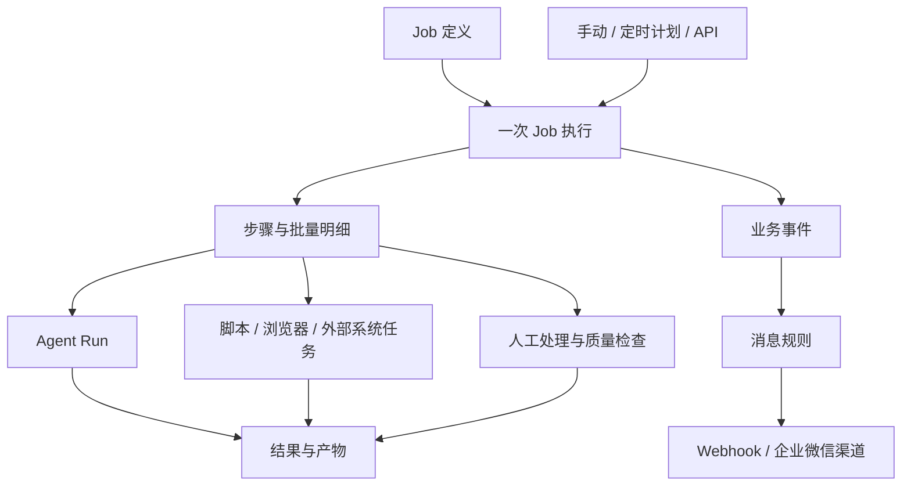

# Forge 后台优化方案：统一 Job 管理与消息管理

日期：2026-11-01（北京时间）　版本：1.0（本轮规则定稿）

状态：**READY FOR DESIGN**。用户本轮明确要求“按你推荐的规则定稿，Job 和消息管理一起纳入，继续完善详细需求、开发设计、数据库和接口设计”，据此采纳本文推荐规则，并授权确定有界默认值。需求与设计就绪不代表代码已实现或业务已验收。本轮只维护文档，不修改产品代码、不执行迁移、真实发送、提交、推送或部署。

## 1. 目标与已有决定

目标是让 Forge 能统一管理业务任务从受理、排队、多步骤执行、人工处理到文件及业务结果交付的过程，复用现有 Agent、模型、工具、凭据、权限与审计。优化依据来自 ReportForge、产品分类、Chatbot 加装、小语种简站四个项目的本地源码取证。

| ID | 决定或问题 | 来源 | 状态与影响 |
| --- | --- | --- | --- |
| D01 | 提供覆盖前轮共性缺口的后台优化方案 | 用户“给我优化的方案”及前轮八项能力分析 | 已确认交付方案；本文细则仍须区分建议与已确认规则 |
| D02 | Job 统一支持手动、定时、API 触发，包含批量子项、执行记录和失败恢复 | 用户本轮对 Job 范围选择的明确回答 | 已确认；REQ-JOB-01/02/03 |
| D03 | 新增消息管理配置功能，将 Webhook 配置归入消息管理 | 用户本轮明确要求 | 已确认；REQ-MSG-01～04，不仅修改菜单名称 |
| D04 | 复用已有凭据库、账号/全局角色、revision、服务端权限、审计和租约恢复 | 现有项目规范与[实现状态](../docs/05-development/implementation-status.md) | 明确继承；不得把已有能力重复计为全新模块 |
| D05 | 企业微信渠道支持成功、失败、待审批通知，指定成员ID/手机号；启用后发送，测试需显式操作 | [前轮已确认需求 D03/D07、U08](20261031-233358-账号权限三方API与群通知-详细需求文档.md) | 明确继承；收口到本轮消息管理，不能丢失原有范围 |
| D06 | 专用 Linux 执行器、Thread 文件保留、空闲回收计算、既定网络边界及 Pi/Temporal 路线继续保留 | [既有补齐方案](2026-10-31-forge-completion-plan.md)与项目规范 | 明确继承；本轮增加业务验收场景，不重新选择底座 |
| P01 | Job 定义、一次执行、步骤/批量明细与 Agent Run 按第3节划分 | 用户本轮“按你推荐的规则定稿” | 已确认采纳；保留原ID，避免新建两个并列业务任务系统 |
| P02 | 旧应用回调兼容其原事件/签名/归属；消息统一配置，应用只展示关联与跳转 | 用户本轮采纳推荐规则 | 已确认；影响 REQ-MSG-04 与公开兼容承诺 |
| P03 | 暂停到安全边界、取消不回滚外部副作用、失败子项优先重试；停用定义不自动取消在途执行 | 用户本轮采纳推荐规则及既有Run约束 | 已确认；第4节按此实施 |
| P04 | 消息停用挂起待发/待重试；修改地址不把旧消息自动转发；恢复渠道不自动全量补发 | 用户本轮采纳推荐规则 | 已确认；影响 REQ-MSG-03/04 |
| F01 | 并发、超时、批次上限、重试预算及 Job/消息保留期限 | 用户委托定稿，既有配置与数据保留基线 | 已关闭规则缺口；采用第10节默认/边界，属于设计限额，不是实测容量 |
| F02 | 四项目试点用例、真实样本、环境与外部副作用许可 | 本轮仅授权文档设计 | 后续验收条件；不阻塞产品语义/框架设计；未授权生产、付费模型或真实群测试 |
| D07 | 将推荐规则定稿，Job及消息管理一并进入四类设计 | 用户本轮完整原话 | 已确认；P01–P04关闭，未扩大到编码、发布或外部写入 |

本文0.1中的推荐规则均由D07采纳，历史“建议”措辞按本轮定稿解释；第10节及配套设计给出精确补充。阶段安排是实施依赖顺序，不删减原有范围，也不自动启动开发。现有 E1–E8、U04/U06/U07/U08 等未完成范围继续保留；仅对Job和消息管理交叉部分由本增量细化，不宣称其它专项已完成。

## 2. 当前事实与证据边界

本轮证据级别为 **READ**：静态阅读当前工作区与调用链。相关仓库存在既有未提交改动；没有据此证明生产已部署，也没有重跑产品测试。

| 现状 | 依据 | 对方案的约束 |
| --- | --- | --- |
| 已有 Agent/模型/工具循环、MySQL 队列、租约、审批、SSE 和部分故障恢复 | [实现状态](../docs/05-development/implementation-status.md)、[runLoop](../packages/runtime/src/loop.ts) | 增加业务执行层并复用已有机制，不重建一套 LLM Run |
| 定时任务直接校验 Agent 与执行身份，再创建 Run；实现默认并发 skip | [triggerSchedule](../packages/runtime/src/schedules.ts) | 定时计划迁入 Job 管理时保留身份、时区、幂等和旧行为，不同时启用两个调度入口 |
| Webhook URL 与密钥引用配置在 API App，投递时读取 App 当前配置 | [应用路由](../apps/api/src/routes/admin/apps.ts)、[Webhook 执行](../packages/runtime/src/webhook.ts) | 配置归属、在途目标、凭据授权与应用兼容均需处理，不能只移表单 |
| 当前回调按 App＋事件去重；重放会重置同条记录的尝试数 | [开放平台 Repository](../packages/store/src/repositories/openplatform.ts) | 新消息记录需保留事件、逻辑消息与逐次尝试，迁移不能清空历史或重复排队 |
| 分类流程有条件分支、并行汇合；报告支持按页恢复 | [分类流程](../../leadong_product_class/apps/api/app/workflow_graph.py)、[报告运行器](../../html-report-generator-master/src/report/page_runner/full_report_runner.mjs) | Job 需要确定步骤、业务子项与局部恢复，不能只包装一次 Run |
| 分类有客户审核与终稿门禁；报告导出绑定业务文档版本 | [分类审核](../../leadong_product_class/apps/api/app/publish.py)、[报告导出](../../html-report-generator-master/src/report/runtime/report_service.mjs) | 人工业务任务、可编辑结果与产物版本进入共用机制，领域界面留业务项目 |
| Chatbot 区分提交/确认/未知，并回读验证部署 | [加装脚本](../../AI-ChatBot%20配置加装自动化/chatbot/scripts/setup-inbox.mjs) | 外部写操作结果未知不得直接重做；需对账和人工重验 |
| 小语种有业务资格重验、任务轮次、批次恢复、人工干预和交付催办 | [执行资格](../../小语种简站/english/src/automatic-duplication-scope.mjs)、[查重执行](../../小语种简站/english/src/external-duplication-worker.mjs)、[人工干预](../../小语种简站/english/src/flow.mjs)、[交付巡检](../../小语种简站/english/src/patrol.mjs) | 平台提供校验、等待、互斥和待办机制；具体服务期、月份、语种规则由业务适配器负责 |

## 3. 后台结构与对象关系

建议后台按使用任务组织为：总览；Agent 与能力；Job 管理；消息管理；文件与产物；账号与权限；操作日志与系统设置。复用既有控制台组件与视觉，不在本轮新增视觉风格。

| 对象/入口 | 用途 | 与现有对象的关系 |
| --- | --- | --- |
| Job 定义 | 一类可重复执行的任务，配置执行目标、参数、责任归属和策略 | 例如“Chatbot 加装”“报告生成”“产品分类”“查重批次”；不是某个客户的一次执行 |
| Job 执行 | 一次手动、定时或 API 触发的业务任务记录 | 关联具体项目/站点/周期/外部任务ID、输入版本、发起人与结果；失败恢复保留这条业务记录 |
| 步骤与批量明细 | 一次执行内部的阶段和可独立处理的业务子项 | 报告页、产品项、站点、查重页面等；只有适用任务才拆明细，不强制每个任务产生多层空结构 |
| Agent Run | 某步骤中的 Agent 模型/工具执行 | 继续使用已有 Run、审批、用量、事件与错误；一个 Job 执行可关联多个 Run，也可完全没有 LLM 调用 |
| 定时计划 | 按 Cron/时区触发 Job | 作为 Job 管理的子入口，保留既有服务账号身份与并发语义 |
| 消息规则与渠道 | 业务事件发生后，决定向哪里发送什么内容 | Job/Run/人工任务引用获准规则；Webhook 地址与凭据统一配置在消息管理 |

既有直接创建 Run 的管理/开放/集成调用继续可用，保留 Agent 调试与 Run 查询入口；不要求所有历史 Run 伪造 Job 关联。已有业务系统可通过适配器保留自身业务任务ID，先接入触发、进度、结果和产物，再逐步复用平台步骤。

## 4. Job 管理

### REQ-JOB-01：定义、参数与三种触发方式

使用者为获准构建者、运营人员、服务账号和外部应用。正常路径为“Job 管理 → Job 定义 → 创建/编辑 → 发布启用 → 执行/配置定时计划”，执行后到统一执行记录查看结果。

- 定义包含名称/Key、业务类型、执行目标、参数约定、组织/负责人、版本及运行策略。执行目标选择已有 Agent、已登记的业务流程、既定 Skill/执行器或外部任务适配器；不因新增页面而开放任意宿主命令执行入口。
- 参数提供表单和高级结构化输入，共用同一校验；目标不存在、停用、无权限、参数不合法或依赖不兼容时禁止受理，并定位问题。
- 手动、定时、API 进入同一受理与授权边界，记录触发来源、发起人和实际执行身份。定时明确绑定获准服务账号，API 不借用配置创建人的权限。
- 每次受理固定定义与依赖版本、输入、权限上限和运行策略；执行时仍重验当前主体、凭据与业务资格，撤权不能靠旧快照继续扩大权限。
- 定义停用建议只阻止新触发，在途执行按其实际状态单独取消；历史定义与执行有引用时不可直接删除。编辑新版本不改变在途执行。
- 业务适配器声明幂等键、业务资格和互斥资源，例如项目＋域名或站点＋月份；平台不硬编码这几种领域公式。同键同输入返回已有受理结果，同键异输入明确冲突。

### REQ-JOB-02：步骤、批量和安全恢复

- 先支持代码登记的流程：确定步骤与 Agent 步骤混合、顺序、条件、并行汇合及等待外部结果。首轮不增加拖拽流程编辑器；该建议不改变已确认执行能力范围。
- 批量任务显示总数、已处理数及成功/失败/未知/跳过明细。总数动态或未知时显示已处理数与当前阶段，不编造百分比；已处理不等于成功。
- 成功子项及其证据保留，失败重试增加尝试记录，默认选取可重试失败项；未知项先对账。批次聚合只有在成功子项已保留且失败范围可定位时才能显示“部分成功”。
- 暂停请求在安全边界生效；在途外部调用未结束时显示“暂停中”，停止分派后续步骤。恢复先检查输入/业务版本、当前资格和互斥资源，再从已提交检查点继续。
- 取消先阻止后续分派，再等待或停止受支持的在途执行；无法证明停止时保持“取消中/待核查”，不把外部已发生的动作伪称回滚。
- 整体重新执行创建新的执行记录并关联原记录，明确重做范围；已成功外部写操作仍须目标状态检查、业务幂等或人工确认，不能用新执行ID绕过防重复。
- Worker/外部执行器失联后，旧持有者不得继续回写新状态；业务输入已更新、执行尝试已替换时，旧结果只能作为历史证据，不能覆盖当前结果。

建议执行主状态为：排队中、执行中、等待中、暂停中、已暂停、取消中、成功、部分成功、失败、已取消、已跳过。等待原因分别记录待审批、待人工、待外部结果和待核查；技术执行结果与业务交付结论分别展示。具体状态标识在开发设计中统一定义，不直接扩写当前 Run 枚举。

### REQ-JOB-03：执行器、浏览器与外部任务

- 复用既定专用 Linux 执行器/Thread 工作文件方案，记录运行环境、输入文件、命令或工具调用、输出与诊断引用；不将 API/数据库宿主环境透传执行账号。
- 浏览器任务明确账号、目标站点与会话归属，支持互斥、登录失效反馈、截图/日志以及重新认证后的继续或重验；不承诺任意验证码、风控或令牌能自动解决。
- 外部任务区分“请求未发出、已提交、结果已确认、结果未知”；返回受理不算业务成功。异步完成通过经认证的回调或查询回收，重复/迟到结果不得重复推进或覆盖新尝试。
- 写入结果未知时先查询目标事实；证据不足进入待核查，由获准人员确认下一步，不能归入普通超时重试。
- 长等待释放计算资源，恢复仍使用已保存业务输入及适用检查点；不得因等待重做已完成取数、付费模型调用或外部创建。
- 手动/API 的不同业务对象按 Job 并发预算排队，资源冲突等待可见；定时计划沿用默认 skip。明确失败可按既定策略退避，业务4xx不盲重试，429/临时错误遵守调用方限额与剩余预算。

### REQ-HUM-01：人工工作台与质量门禁

- 从 Job 执行、异常队列或消息链接进入待办，展示处理对象及版本、原因、责任人、已有证据和可用动作。
- 可适用动作包括补充资料、结构化修改、确认结果、驳回重提、暂缓/恢复、人工重验和有理由的放行；动作集合由业务定义约束，不能对所有任务提供无条件“强制成功”。
- 业务复核与高危工具审批分别记录；复核通过不会自动增加工具权限，工具获批也不代表业务质量达标。
- 人工修改形成新版本，保留修改前证据；过期页面提交先检查版本与处理状态，冲突保留非敏感输入并提示重新加载。
- 自动质量检查独立于技术状态：缺数据、来源不完整、Schema失败、待复核有明确原因。人工放行保留原失败事实和理由，不能把缺失资料改写为真实零或自动校验通过。

## 5. 消息管理：集中 Webhook 配置

### REQ-MSG-01：渠道配置

本轮 Webhook 指现有出站业务回调和企业微信群机器人地址。外部执行完成回调属于 Job 执行协议，不能复用出站消息签名就获得任务结果写入权。

消息管理提供“渠道配置、消息规则、消息模板、发送记录”四个页签。渠道首批覆盖现有业务 Webhook 与已确认企业微信通知；其它既有 P1 通知范围继续保留，不在本轮额外增加 SMS/邮件供应商或通用消息中间件产品。

- 渠道配置名称、类型、组织、启停、目标地址、凭据引用和类型特有字段。业务 Webhook 使用事件合同与签名；企业微信使用群机器人协议和指定成员ID/手机号，不能把 Forge 用户ID当成员ID。
- URL、签名密钥及机器人 key 按敏感配置处理：只写或脱敏展示、引用已有凭据库，异常和日志不可泄露。网络与身份边界沿用所属工具/渠道的既定规则，不因迁菜单绕过。
- 保存配置不发送消息；“测试发送”是独立动作，明确选定目标，生成测试记录，不能启动真实 Job 或重发历史业务结果。
- Agent/Job 页仅关联获准规则，应用页仅展示关联摘要和消息管理入口；这些页面不再维护第二套 URL、密钥、模板和重放表单。
- 渠道编辑、启停、测试、删除有独立操作授权与组织/资源范围；被规则或待投递消息引用时禁止无提示删除。

### REQ-MSG-02：事件规则与模板

- 规则选择事件、适用 Job/Agent/API应用或组织范围、获准渠道和通知模板。范围按资源ID和服务端归属匹配，不能按同名或任意前端参数扩大发送范围。
- 继承企业微信成功、失败、待审批三类默认；Job 新增开始、部分成功、待人工、异常积压、交付逾期等作为建议事件，需显式选择后启用，不自动向真实群扩大发送。
- 同一业务有 Job 和嵌套 Run 时，面向人的通知建议默认按 Job 汇总；直接 Run 的既有应用回调保持原范围。规则明确订阅层级，防止每个步骤与最终任务重复刷屏。
- 人类通知模板只提供受控变量，如任务名称、业务对象摘要、状态、执行/审批标识、负责人及后台链接；默认不发送 Prompt、业务正文、工具参数和凭据。模板不执行任意代码。
- 业务 Webhook 的已有事件结构不做自由文本模板化；字段与版本按公开契约维护，接收方解析兼容性独立验收。
- 规则、模板更新只影响新产生消息；已入队消息保留当时的事件、渲染内容与关联版本，重试不静默换成新文案或新范围。

### REQ-MSG-03：发送、重试与恢复

- 发送记录关联事件、规则、渠道版本、Job/Run/人工任务及业务对象，保留每次尝试的时间、结果、脱敏响应、错误、下次尝试与操作人。手工重发不能抹掉原有次数和结果。
- 逻辑消息按稳定事件＋订阅/渠道去重；尝试记录独立。事件写入与发送意图必须可恢复，任务已完成但发送进程重启不能使通知永久遗漏。
- 状态至少区分待发、发送中、成功、明确失败、结果未知及挂起；投递成功不代表群成员已读，也不代表客户业务交付完成。
- 成功判定按类型：业务 Webhook 继承现有响应合同；企业微信同时检查渠道业务响应，不能统一以 HTTP 200 判成功。
- 业务 Webhook 建议保持至少一次投递与稳定事件ID，由接收方幂等；网络超时保留本次结果未知，可按该合同退避重试，不能声称只会收到一次。
- 企业微信按既定去重、节流和有限重试规则处理；无法确认是否已发送时保留未知事实，人工重发提示可能重复并记录理由，不能把未知冒充未发送。
- 消息失败不改写 Job/Run 的业务结果；消息异常进入自己的队列、指标与处理记录。
- 停用渠道建议阻止新的发送及重试、挂起未完成消息；已发出的请求仍回收真实结果，停用不等于撤回已发送消息。恢复后历史补发需明确选择范围。地址修改后旧消息不得自动改投新地址；待发/待重试消息进入待处置，重新投递保留原关联和审计。
- 同一 Secret 正常轮换使用当前有效凭据，撤销/停用后失败关闭；不可为了重放使用已撤销值。

### REQ-MSG-04：现有 Webhook 平滑归入消息管理

建议采用以下兼容路径，具体数据与接口规格由后续开发设计给出：

1. 盘点现有应用的回调配置、组织、凭据绑定、待发/重试消息和投递历史；本次不读取生产或输出真实地址。
2. 为有效旧配置建立一对一消息渠道与原事件范围的规则映射；不因迁移额外启用渠道、测试发送或扩大接收范围。
3. 保留历史事件ID、投递ID、实际次数、结果与待重试时间；已有记录建立关联，不能重新生成一批待发消息。
4. 调整凭据的受控消费者绑定与指定资源授权；迁移 `api_app` 到消息渠道不能只复制 Secret ID，也不能放大可使用范围。迁移前后实际签名密钥和验签结果兼容。
5. 新旧内部配置入口汇入同一权威配置及并发版本检查，兼容读取旧字段；新界面只在消息管理编辑。保留原应用回调的公开事件、签名和结果查询语义。
6. 每个逻辑事件明确唯一发送路径，切换中不同时运行旧发送器与新订阅发送器处理同一投递；对账后再停止旧路径。历史已成功记录不因切换再次发送。
7. 先扩展并保持旧字段/关联的恢复能力；破坏性清理延后。回退不同时开启两条投递链，不重放已成功历史；数据库迁移继续 forward-only。

配置移入消息管理后，应用仍可显示“关联渠道/最近发送结果”和跳转；原有应用管理权限只迁为该应用回调的等价操作范围，不自动得到其它组织或渠道的管理权。

## 6. 其它共性能力与已有补齐范围的合并

| 需求 | 最小完整方案 | 对应既有范围 |
| --- | --- | --- |
| REQ-DATA-01 数据源、输入快照与证据 | 业务响应/分页完整性校验、缺失与真实零区别、取数时间、来源状态和证据引用；采集输入关联执行版本；执行前重新检查业务资格 | 既有工具/Connector、E1快照、E4接口目录；来源质量规则补充进业务适配契约 |
| REQ-FILE-01 文件与交付产物 | 输入文件、结构化中间数据、人工编辑结果、最终导出关联同一业务版本与步骤；权限下载、预览、校验和、保留与失效；重生保护人工修改 | E3执行器/文件/Artifact及 FR-FL，原定范围不缩减 |
| REQ-VER-01 配置、Prompt与质量回归 | 固定 Job/Agent/Skill/工具/模型配置与输入；按步骤追溯版本、成本、Schema错误；质量检查与离线样例回归、版本对比保留独立结果 | E1/E2快照与 FR-EV；不再新增另一套同义revision系统 |
| REQ-OBS-01 运行与交付运营 | 按Job/业务对象/组织/模型查看执行、队列等待、失败/未知、人工待办、成本；责任人、交付事实回查、工作日催办与升级由业务提供规则；执行成功和业务交付分别统计 | E5运行/限流与 FR-OB/U08；明确复用消息管理 |
| REQ-BASE-01 治理与集成基础 | 新资源覆盖功能权限/数据范围、服务端查询过滤与下载/SSE二次校验、审计、错误、契约、SDK；配额跨触发方式共享，不给Job绕过Agent或应用配额 | 原E1–E8、U04/U06/U07；不把新增页面当作已有平台能力完成 |

报告画布/页模板、分类树/方案编辑、分类阈值、语种推荐和服务期等继续由业务项目负责。业务库保留权威事实，Forge 先通过适配器取得状态与交付证据，不先要求搬迁四个业务系统。

## 7. 页面任务、权限与异常反馈

| 页面/交互 | 正常操作与可见结果 | 失败、并发与重访 |
| --- | --- | --- |
| UI-J01 Job定义 | 筛选/分页、详情、编辑版本、启停、参数表单、手动执行及定时计划入口 | 加载/空/无匹配/错误/无权限分开；冲突不覆盖草稿；停用对象刷新后不可新触发 |
| UI-J02 执行记录/详情 | 按Job、来源、状态、业务对象和时间筛选；查看步骤/批量明细、关联Run、证据/产物、消息；获准后暂停/恢复/取消/重试 | 关闭页面不取消后台；响应丢失先查受理结果；重访读持久状态；失败项与未知项有各自恢复入口 |
| UI-J03 定时计划 | 在Job下创建/启停计划，预览下次执行、实际身份、最近结果及跳过原因；历史菜单可兼容跳转 | Cron/时区非法字段定位；服务账号失效停止新触发；重复执行不会被新旧入口各触发一次 |
| UI-J04 人工处理 | 从异常列表/详情/消息链接打开，查看证据、填写意见并执行获准动作 | 旧版本/已被处理/撤权时拒绝；保留非敏感意见；成功后显示当前处理人、结果与后续步骤 |
| UI-M01 渠道/规则/模板 | 在消息管理统一编辑，显示引用与启停；测试由明确按钮触发并显示记录 | 保存不自动发送；敏感值仅表单内存，关闭清空；409保留可保留输入；测试未知不能显示明确失败 |
| UI-M02 发送记录 | 按渠道、事件、Job/Run、状态与时间筛选；详情显示尝试历史；获准后重试/重发 | 重发前显示重复风险；权限不足不能靠Job关联越权读正文；记录刷新后与实际发送状态一致 |
| UI-A01 应用关联 | 应用详情显示回调关联摘要，跳转消息管理的对应对象 | 没有消息配置权限则仅展示可见元数据，不提供可写URL或绕过入口 |

权限在产品层区分查看定义/编辑发布/触发/执行控制/处理人工任务，以及查看消息/配置渠道规则模板/测试发送/重发。具体权限码由后续设计按现有集中注册表定义；管理员不得授予自身没有的权限或数据范围。责任人不自动等于执行身份。

字段与边界集中约定：

| 项目 | 约定、来源与待决边界 |
| --- | --- |
| 名称/Key/描述 | 使用L01的长度、计量与空值规则；不静默截断、不改变历史标识，字段映射见配套接口设计 |
| 参数、批量输入 | 执行目标Schema决定必填/空值/类型；零项批次不产生业务执行，非法项明确定位。整批拒绝或逐项受理的策略须由任务类型显式声明，不能在同一Job静默变化 |
| 并发、重试、时间 | 使用L03–L06；尝试次数含首次且至少1（额外重试可为0）；限额是规则，不宣称已确定吞吐容量 |
| 时间与周期 | 存UTC，界面按约定本地时区；计划保存明确时区。业务自然月/工作日由适配器定义，不能把所有项目硬编码为同一种日历 |
| URL与敏感值 | 沿用现有安全和凭据约束；URL按类型校验，机器人key/签名值不进入普通配置响应；清空、保持原值与替换要明确区分 |
| 模板与渠道限制 | 使用受控变量；字节/长度/频率继承适用渠道合同，企业微信沿用前轮U08，实施时复核协议；超限阻止保存/发送并定位，不能静默丢事件或截坏标识/链接 |
| 列表与选中范围 | 继承稳定分页/筛选约定；批量操作明确仅选中项或当前条件全集，不把当前页误当全部；执行前重新校验每项状态和权限 |
| 历史与保留 | 定义版本、输入/来源、执行/尝试、人工决定、产物和消息分别关联；按L07保留，审计追加，活动/未知/被引用对象不清理 |

字段错误使用内联提示并定位，提交中防重复。持续网络故障使用区域提示并保留非敏感输入；恢复后先查询状态。成功反馈后刷新读回。暂停/取消及重发等有真实副作用或重复风险的操作展示本次对象和影响；普通查看、保存配置不新增泛化审批。继承键盘、焦点恢复、无障碍和窄屏基线，不在页面额外铺设说明段落。

## 8. 验收场景与追踪

以下为后续待执行验收，不是本次已通过结果。场景使用四项目现有业务形态规划；真实样本、测试环境和副作用许可见F02，未将临时合成数据当作真实业务验收。

| AC | 前置与操作 | 必须成立的结果与禁止结果 | 关联 |
| --- | --- | --- | --- |
| AC-J01 | 同一Job分别从手动、定时、API受理合法参数 | 均生成可查询执行记录，来源与实际身份准确；不得绕过同一权限/配额/业务资格 | JOB-01、BASE-01、UI-J01/03 |
| AC-J02 | 受理响应丢失后同键重试，再用同键换参数 | 首次结果可查询，同输入不重复执行，异输入冲突；不能创建第二个外部对象 | JOB-01、UI-J02 |
| AC-J03 | 报告已有成功页，其余页失败后选择重试 | 成功页及人工编辑保留，重试目标与新尝试可追踪；不能整份无条件重生 | JOB-02、FILE-01、UI-J02 |
| AC-J04 | 批量任务同时有成功、失败、未知及跳过项 | 各项事实保留，聚合状态准确；未知项不计成功，也不作为普通失败自动重做 | JOB-02/03、UI-J02 |
| AC-J05 | 外部部署已提交但响应超时/进程重启 | 回读查明或转人工；不得直接重复创建/部署，不得把受理当成功 | JOB-03、HUM-01、UI-J02/04 |
| AC-J06 | 执行中暂停、取消、重新进入页面 | 请求态与实际停止区分，后续步骤不再派发；已发生写入不伪称撤销 | JOB-02、UI-J02 |
| AC-J07 | 输入版本更新或旧Worker失租后，旧结果迟到 | 旧结果不覆盖新版本/尝试，保留诊断；不能继续发出新的副作用 | JOB-02、VER-01 |
| AC-J08 | 定时服务账号失效或业务资格在执行前撤回 | 新执行或后续受控动作拒绝/挂起，原因可见；不回退创建人身份或缓存资格 | JOB-01/03、BASE-01、UI-J03 |
| AC-H01 | 分类审核驳回、修改、重提、通过，再由旧页面提交 | 新版本/意见可追溯，只有当前有效决定推进；工具审批不被当作客户审核通过 | HUM-01、UI-J04 |
| AC-D01 | 输入来源分别返回真实零、缺失和部分数据 | 来源/覆盖范围可追溯，门禁结果不同；缺失不得改写为零或已验证通过 | DATA-01、HUM-01 |
| AC-F01 | 人工修改后重生或导出、再尝试无权限下载 | 编辑保护与业务版本关联准确，下载服务端拒绝越权；不返回永久公开路径 | FILE-01、BASE-01 |
| AC-V01 | 发布新Prompt/Skill/模型配置后恢复旧执行 | 既定依赖不漂移，当前撤权仍生效，版本/成本可追溯；不伪造历史快照 | VER-01、JOB-01 |
| AC-M01 | 保存新渠道，再明确点击测试 | 保存零发送；测试有独立记录且不启动Job；敏感URL/key不回显 | MSG-01、UI-M01 |
| AC-M02 | 同事件重复处理，及一个Job下多个Run完成 | 单订阅逻辑消息去重；默认汇总规则不刷屏；旧应用回调订阅范围不被扩大 | MSG-02/03 |
| AC-M03 | HTTP成功但企业微信业务响应失败 | 按渠道事实记录失败；不标成功/已读，不改变Job结果 | MSG-03、UI-M02 |
| AC-M04 | 回调或群发送超时、人工重发、进程重启 | 按类型保留未知事实及稳定ID，尝试历史不清零，重复风险可见 | MSG-03、UI-M02 |
| AC-M05 | 渠道停用/换地址时存在待发与待重试消息 | 不擅自发送或改投；明确处置后才恢复，并能追溯旧渠道/内容版本 | MSG-03/04、UI-M01/02 |
| AC-M06 | 迁移旧应用回调、历史及在途消息并切换新入口 | 事件/签名合同兼容、旧历史可查、每条逻辑消息唯一发送路径；不重复排队/丢记录/扩权 | MSG-04、UI-A01 |
| AC-M07 | 组织A人员尝试读取/测试/重发组织B消息 | 服务端拒绝，不通过应用、Job链接或消息关联绕过；安全审计可查 | MSG-01/03、BASE-01 |
| AC-O01 | Job技术完成但客户尚未实际交付，消息暂时失败 | 执行、消息、业务交付分别显示；催办按业务规则关联责任人，不伪称已交付 | OBS-01、MSG-03 |

原始要求追踪：统一Job→REQ-JOB-01～03/AC-J01～11；消息配置与Webhook归入→REQ-MSG-01～04/AC-M01～10；前轮八类缺口→JOB/HUM/DATA/FILE/VER/OBS/BASE各项，均保留去向。F01已由第10节关闭，F02真实样本仍按后续验收许可取得，不能据场景表宣布已验收。

## 9. 分批落地与交接

以下为本轮采纳的实施依赖顺序，不删除既有未完需求，也不承诺未经验证的工期。

| 批次 | 交付范围 | 验证出口 |
| --- | --- | --- |
| A：统一入口与兼容基础 | 按已确认P01～04与L01–09实施；Job定义/一次执行/三类触发/查询；消息渠道/规则/记录；旧应用Webhook与定时计划的兼容映射；必要权限/契约 | 相同业务不重复受理，新旧入口只一条执行/发送链，权限和迁移对账成立 |
| B：恢复与人工处理 | 确定步骤、批量子项、检查点/尝试/过期结果保护、外部等待与对账、人工待办；同步推进已规划执行器/文件依赖 | 失败项可恢复、成功项不重做、未知副作用可核实，人工处理后从正确位置继续 |
| C：版本化业务交付 | 资料/来源快照、结构化中间数据、人工编辑保护、产物版本/预览/下载、质量门禁及完整运行依赖快照 | 报告按页恢复与导出、分类审核到终稿均可追溯，数据缺口不伪装成功 |
| D：持续运营 | 按步骤Prompt/模型质量回归、成本与并发/配额、积压和待办、企业微信完整通知、交付催办与升级 | 执行/消息/交付指标独立准确，告警与重发有范围、去重和恢复证据 |

企业微信既有U08范围继续完整保留；基础事件与渠道随A/B交付，完整运营能力随D补齐。Temporal/Redis按既定E5推进；不能把换引擎作为业务恢复验收的替代，也不能为等待换引擎另建长期并行调度器。

试点建议：先将 Chatbot 既有脚本作为确定性任务接入，验证受理→排队→阶段进度→回读→未知转人工→诊断产物→通知；再以 ReportForge 验证按页恢复和版本化交付；产品分类覆盖并行、业务审核与终稿；小语种覆盖长等待、批次限流、资格重验和交付催办。四项目先保留业务系统与业务库，避免一次性迁库/重写。

采纳后，开发设计须同步：需求编号与优先级、运行时/控制台/权限架构、管理/开放/集成契约与OpenAPI/SDK、MySQL数据设计/Schema/迁移、凭据消费者与保留规则、发布/迁移/回退步骤及实现状态。本文未预造具体表、API路径、错误码或权限码。

交接结论：本范围规则已定稿，P01–P04、F01有明确去向，**READY FOR DESIGN**。F02仍是后续真实验收条件，不伪称已取得或已执行；其它既有专项依赖及实施状态见配套开发设计，不自动进入开发或生产操作。

## 10. 本轮定稿的精确规则

本节优先于0.1草案中的待定表述；产品常量与单位只在本节定义，设计和接口引用规则编号。

| 规则 | 默认值/范围（端点均包含） | 来源与处理 |
| --- | --- | --- |
| L01 名称/Key/描述/原因 | 名称1–128、描述0–1024、操作原因1–1024个Unicode码点；Key为2–64位小写字母、数字、连字符且首位字母或数字 | 沿用同类资源长度；名称/Key去首尾空白后校验，描述/原因保留正文，纯空白原因无效；超限拒绝，不截断 |
| L02 输入/批次/流程 | 单次受理JSON请求体（含input/businessRef/items与空白，不含HTTP头）最多1 MiB UTF-8；单明细规范序列化最多64 KiB；每次执行1–1000项；定义最多128节点，循环每节点最多100轮；执行累计展开最多100000个逻辑步骤 | 总大小/单项/数量同时校验，零项/任一非法项整批拒绝；按需展开，越过累计步骤上限失败并保留事实，不提前分配循环笛卡尔积；不同边界分别构造其余约束合法的载荷 |
| L03 并发 | 每Job活动执行默认1、范围1–20；批量并行默认2、范围1–16；平台默认2个实际计算槽；每Job最多50条尚未启动的排队执行 | 平台默认参照MAX_CONCURRENT_RUNS=2；纯等待/暂停释放活动许可，账号/站点锁仍保留；计划skip另按在途执行判断。排队满则429且不新增受理记录，嵌套Agent不重复占同一槽；不是吞吐保证 |
| L04 超时/等待 | 步骤默认300秒、范围1–86400；累计活动执行默认3600秒、范围1–604800；单次外部/人工等待默认7天、范围60秒–90天 | 等待/暂停不计活动计算时长，但受等待截止约束；截止后已知无副作用才失败，否则待核查；无期限循环不允许 |
| L05 重试/预算 | 自动尝试默认2、范围1–5（含首次），退避5/30/120/300秒，429以Retry-After与剩余截止为限；同执行最多3轮人工失败恢复；预算默认USD 1、范围0.000001–10000.000000 | 保留当前2次模型/工具尝试基线；Job、步骤及下游重试共享总尝试/时间/费用预算，不相乘。副作用未知不自动重试；预算调整需新执行版本，不原地放宽快照 |
| L06 消息 | 通用Webhook超时10秒；沿用1分/5分/30分/2时/6时退避，最多6次含首次；企业微信20条/分钟且单文本2048 UTF-8字节；每组织同事件最多100个接收渠道（含全局规则） | Webhook继承当前实现，企业微信继承U08；配置事务检查fanout上限。429/明确临时失败有限重试，群消息未知不自动再发；内置摘要模板只裁剪可变名称/说明且保留标识/链接，自定义模板渲染超限明确失败不发送，不自动换模板 |
| L07 保留 | 执行正文/步骤/证据/Run事件180天，消息正文及尝试30天，已处理outbox7天，审计365天；未引用上传7天 | 继承MySQL设计基线；活动/待人工/未知/被引用数据不清理。业务去重及消息去重最小元数据在源事实/定义仍保留时继续保留；Thread工作文件继承“无显式策略不自动删除” |
| L08 列表/补发 | 默认50、范围1–200；每次控制/补发明确选择1–100个对象 | 逐项重验权限/状态后整批受理；非法/越权不部分执行。重新启用渠道只恢复未来发送，历史挂起需明确补发；已发出请求回收真实结果 |
| L09 定时并发 | 默认skip；queue为一个待运行槽；cancel_previous一并保留；catchupWindow=60秒 | cancel_previous必须等待前次确认停止后再开始；结果未知不抢占账号/站点锁。迁移历史非skip先核查；更早积压仅显式回填，不沿用旧代码“无条件入队” |

外部副作用与取消的事实记录使用 `not_submitted/submitted/confirmed/unknown`；Job主状态与等待原因、业务交付状态、质量状态分别定义，不能压成一个成功布尔值。批次终态仅在无在途/等待/未知项时聚合；任何未知项先进入waiting/reconcile。

权限：新资源默认拒绝；手动使用本人身份，API使用App有效Scope与Job显式授权，定时使用服务账号；均与Job绑定能力及数据范围取交集。Run和Job的正常升级不扩大运行中的权限。迁移只映射既有单应用/单计划的等价授权，不批量给旧角色增加全局Job/消息管理权。

新增验收（均待实现后执行）：

| AC | 精确反例与预期 |
| --- | --- |
| AC-J09 | 0/1/1000/1001项；项大小和总大小边界分别构造可达载荷。合法边界受理，其余整批拒绝且无执行记录/外部副作用 |
| AC-J10 | 初次失败后自动尝试用尽，再人工恢复3轮；第4轮人工恢复拒绝，不生成新尝试；嵌套重试总量不得乘法放大 |
| AC-J11 | 预算接近耗尽时两个并行分支预占额度；总预占不超上限，未获预算分支不调用模型；等待Agent不占用第二个相同计算许可 |
| AC-M08 | 2048/2049 UTF-8字节通知分别可发送/拒绝；中文与emoji按字节校验；21条同分钟事件进入节流队列且不丢记录 |
| AC-M09 | 渠道发出请求后被停用，响应随后成功：本次记真实成功，后续不发；重新启用不自动补历史 |
| AC-M10 | 回调密钥轮换、资源级Secret、地址更换和旧接口并发编辑组合：凭据不扩权，旧消息不改投，旧表单409不覆盖新配置 |
| AC-O02 | 活动/未知任务超过正文保留期限：不得清理；终态正文清理后保留去重事实，不因HTTP幂等缓存24小时到期重复创建业务对象 |

### 10.1 配套设计与范围追踪

- [开发设计](20261101-113405-Forge后台优化与Job消息管理-开发设计文档.md)：状态机、受理/执行/恢复、权限、消息与迁移顺序。
- [数据库设计](20261101-113405-Forge后台优化与Job消息管理-数据库设计文档.md)：新增/扩展表字段、约束、事务、索引、回填与保留。
- [接口设计](20261101-113405-Forge后台优化与Job消息管理-接口文档.md)：管理/开放/集成入口、DTO、事件、错误、兼容及UI数据来源。

REQ/AC原编号不变；正式需求索引增加FR-JB/FR-MS并映射这些编号。数据来源、产物、人工质量和运营能力仍分别对应既有FR-FL/FR-EV/FR-OB/FR-GV及E1–E8，不把本增量就绪扩展为全部框架已实现。

### 实施确认（2026-11-01）

同一事件同时命中同一渠道的多条规则时，每个event/channel仍只生成一条投递。按 Job → Agent → API应用 → 组织 → 全局选择最具体范围规则的模板；冻结并保留全部命中规则及选中规则ID。此优先顺序已由用户在实施阶段确认。
