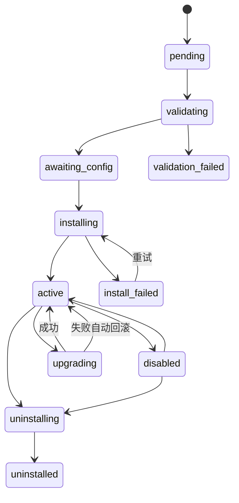

# Forge 插件系统设计

版本：1.0　日期：2026-10-21　状态：待评审

> 目标：Agent、Skill、MCP、工具包、模型供应商都能安装、启用、停用、升级、回滚、卸载，且不破坏运行中的 Run。

## 1. 目标与非目标

**目标**
- 一套统一包格式覆盖五类能力资源。
- 控制台可完成上传、预检、安装、配置、升级、回滚、卸载。
- 安装有作用域（全局/组织/角色），支持按客户差异交付。
- 运行固定依赖版本；配置热更新不影响进行中的 Run。
- 上传包默认不执行任意代码。
- 安装全过程可审计、可回滚。

**非目标（P0）**
- 公共插件市场与在线计费。
- 控制台上传并执行代码型插件。
- 插件自带数据库迁移。
- 任意二进制随包分发（MCP 二进制由镜像/运维提供）。

## 2. 扩展点与资源类型

| 类型 | 包 `type` | 产物 | 运行时 |
| --- | --- | --- | --- |
| Agent 包 | `agent` | Agent 定义 + Prompt + 引用 | Agent 版本 |
| Skill 包 | `skill` | `SKILL.md` + 资源文件 | 上下文注入 |
| MCP 配置包 | `mcp` | 连接配置 + 工具策略 | 远程服务或 stdio 进程 |
| 工具包 | `tool` | OpenAPI / Connector 清单 + 策略 | HTTP 执行器或 Agent Connector |
| 模型供应商包 | `provider` | 端点 + 模型目录 + 路由 | 模型网关 |
| 混合包 | `mixed` | 上述资源组合 | 按资源类型 |

**资源 Key 规则**：小写字母、数字、点、连字符，2–64 字符；同一类型内全局唯一。包 Key 建议反向域名（`com.acme.contract-review`），资源 Key 用短名（`contract-reviewer`）。包内资源可引用外部已安装资源，不应重复打包公共依赖。

## 3. 包格式

### 3.1 归档

- 扩展名 `.forgepkg`，内容为 gzip 压缩的 tar，根目录必须含 `forge.plugin.json`。
- 默认限制：≤20 MB、≤5000 个文件、单文件 ≤10 MB、路径 ≤200 字符。
- 禁止：绝对路径、`..`、符号链接、设备文件、可执行位、嵌套归档炸弹。
- 包内不得包含明文密钥；配置值通过 secret 引用在安装时绑定。

### 3.2 目录结构

```
com.acme.contract-review/
├── forge.plugin.json
├── checksums.json
├── signature.minisig          # P1，可选
├── config.schema.json         # 安装配置（JSON Schema）
├── config.ui.json             # 控制台表单布局（可选）
├── README.md
└── resources/
    ├── agents/contract-reviewer.yaml
    ├── skills/contract-review/SKILL.md
    ├── skills/contract-review/assets/checklist.md
    ├── mcp/doc-parser.yaml
    ├── tools/erp.yaml
    └── providers/acme-llm.yaml
```

### 3.3 manifest

```json
{
  "schemaVersion": "1",
  "key": "com.acme.contract-review",
  "name": "合同审查能力包",
  "version": "1.2.0",
  "type": "mixed",
  "description": "合同审查 Agent + 技能 + ERP 工具 + 文档解析 MCP",
  "vendor": { "name": "Acme", "contact": "platform@acme.internal" },
  "compatibility": {
    "forge": ">=2.0.0 <3.0.0",
    "pi": ">=1.3.0 <1.4.0"
  },
  "resources": {
    "agents": ["resources/agents/contract-reviewer.yaml"],
    "skills": ["resources/skills/contract-review"],
    "mcpServers": ["resources/mcp/doc-parser.yaml"],
    "toolSources": ["resources/tools/erp.yaml"],
    "providers": []
  },
  "dependencies": [
    { "type": "mcp", "key": "doc-parser", "range": ">=1.0.0 <2.0.0", "optional": false },
    { "type": "skill", "key": "legal-style", "range": "^1.2.0", "optional": true }
  ],
  "permissions": {
    "network": ["erp.acme.internal", "doc-parser"],
    "secrets": ["erp_api_key", "acme_llm_key"],
    "files": ["read"],
    "scripts": false
  },
  "configSchema": "config.schema.json",
  "uiSchema": "config.ui.json",
  "checksums": "checksums.json",
  "signature": "signature.minisig"
}
```

| 字段 | 必填 | 说明 |
| --- | --- | --- |
| `schemaVersion` | 是 | 当前为 `1`；不兼容升级时递增 |
| `key` / `version` | 是 | SemVer；同 Key 同版本不可重复发布 |
| `type` | 是 | `agent/skill/mcp/tool/provider/mixed` |
| `compatibility` | 是 | 框架与 Pi 版本范围；安装时校验 |
| `resources` | 是 | 资源文件相对路径 |
| `dependencies` | 否 | 资源或包依赖及版本范围 |
| `permissions` | 是 | 网络、密钥、文件、脚本；安装时展示 |
| `configSchema` | 否 | 安装时必须填写的配置 |
| `checksums` | 是 | 除自身与签名外的文件 SHA-256 |
| `signature` | P1 | minisign 签名 |

### 3.4 资源描述示例

**Agent 定义** `resources/agents/contract-reviewer.yaml`

```yaml
schemaVersion: 1
key: contract-reviewer
name: 合同审查助手
description: 审查合同条款，输出风险与修改建议
version: 0.1.0
model:
  route: legal-default
  params: { temperature: 0.2 }
instructions: prompts/reviewer.md
skills: [contract-review]
toolsets:
  - mcp: doc-parser
    allow: [parse_pdf, ocr_image]
  - openapi: erp
    allow: [get_contract, list_suppliers]
  - builtin: [web_fetch]
approval:
  highRisk: [submit_approval]
  timeout: 72h
limits:
  maxSteps: 50
  maxCostUsd: 2
output:
  schema: schemas/review-result.json
api:
  enabled: true
  scopes: [runs:create, runs:read]
```

**Skill** `resources/skills/contract-review/SKILL.md`

```markdown
---
name: contract-review
description: 按公司法律口径审查合同，输出风险等级与修改建议
version: 1.0.0
allowed-tools: [parse_pdf, get_contract]
---

# 合同审查

1. 先读取合同全文与相关供应商信息。
2. 按检查清单逐项标注风险等级。
3. 输出结构化结果，引用条款原文。
```

**MCP** `resources/mcp/doc-parser.yaml`

```yaml
schemaVersion: 1
key: doc-parser
name: 文档解析
transport: http
url: http://doc-parser:8080/mcp
auth: { type: none }
timeoutMs: 60000
tools:
  allow: [parse_pdf, ocr_image]
  risk:
    ocr_image: low
healthCheck: { intervalSeconds: 60, timeoutMs: 5000 }
```

stdio 示例（命令需在服务端命令白名单内）：

```yaml
schemaVersion: 1
key: erp-mcp
transport: stdio
command: ["node", "/opt/forge/mcp/erp/dist/index.js"]
env:
  ERP_BASE_URL: { value: "https://erp.internal" }
  ERP_API_KEY: { secret: erp_api_key }
limits: { memoryMb: 512, timeoutMs: 30000 }
```

**工具包** `resources/tools/erp.yaml`

```yaml
schemaVersion: 1
key: erp
name: ERP 接口
spec: openapi/erp.yaml
baseUrl: https://erp.internal/api
auth: { type: bearer, secret: erp_api_key }
tools:
  include: [get_contract, list_suppliers, submit_approval]
  overrides:
    submit_approval:
      risk: high
      description: 提交合同审批，产生外部副作用
```

**Provider** `resources/providers/acme-llm.yaml`

```yaml
schemaVersion: 1
key: acme-llm
name: Acme 内网模型
protocol: openai-compatible
baseUrl: https://llm.acme.internal/v1
auth: { type: bearer, secret: acme_llm_key }
headers: { X-Tenant: acme }
models:
  - key: acme-chat-32b
    displayName: Acme Chat 32B
    capabilities: [text, tools, json_schema, streaming]
    contextWindow: 32768
    maxOutputTokens: 4096
    pricing: { inputPerMillionUsd: 0.2, outputPerMillionUsd: 0.6 }
```

> Provider 包只含配置与秘密引用，不含 API Key 明文；不支持的协议走 P2 代码适配器。

## 4. 生命周期

### 4.1 状态



- **PackageVersion** 状态：`ready`、`deprecated`、`blocked`。
- **Installation** 状态：`pending/validating/awaiting_config/installing/active/disabled/upgrading/uninstalling/failed/uninstalled`。
- 任何状态变更写审计与事件；失败保留错误码与实际步骤。

### 4.2 安装流水线

1. **接收**：上传文件或 URL；计算 SHA-256；落对象存储；创建 `plugin_versions`（未校验）。
2. **归档校验**：大小、文件数、路径、链接、权限、checksum 清单。
3. **manifest 校验**：Schema、版本、类型、资源路径、Key 冲突、兼容范围。
4. **安全校验**：签名（P1）、权限清单、MCP 命令白名单、脚本声明、禁止明文密钥。
5. **依赖解析**：查找已安装资源/包；不满足则进入 `awaiting_config` 并给出修复建议。
6. **Dry-run**：生成将创建/覆盖的资源 diff、缺失配置、所需秘密与网络权限。
7. **配置**：按 `config.schema.json` 校验；秘密单独写入凭据库。
8. **安装事务**：写包、版本、资源版本、安装记录与资源映射；状态 `installing`。
9. **连通性检查**：MCP 健康与工具发现、OpenAPI 解析、Provider 可选测试。
10. **激活**：状态 `active`，递增 registry epoch，推送事件，写审计。
11. **失败补偿**：回滚事务/活动指针；停止新启动的 MCP 进程；保留失败记录供排障。

安装工作流由 Temporal `PackageInstallWorkflow` 承载，UI 轮询安装详情；也可在 CLI 中等待完成。

### 4.3 升级与回滚

- 升级 = 安装同一包 Key 的新版本；解析依赖 → 创建新安装版本 → 健康检查 → 原子切换 `active_version_id`。
- 声明式资源直接切换；MCP 旧连接排空（默认 60s）；代码型扩展需滚动重启 Worker。
- 失败自动回滚到旧版本，保留错误与 diff。
- 手动回滚只能回滚到仍在保留期内（默认 30 天）且兼容当前框架的版本。
- 升级不修改已发布 Agent 的固定版本；引用范围需要重新解析时由用户确认。

### 4.4 卸载

1. 引用检查：已发布 Agent / 其他安装是否依赖。
2. 有引用 → 阻止；显示引用方与迁移建议。
3. 无引用 → `uninstalling`；停止新调用；运行中调用排空（默认 30 分钟）。
4. 删除资源版本与安装映射；保留包归档与审计 N 天；状态 `uninstalled`。
5. 强制卸载仅管理员可用，需二次确认，运行中 Run 立即取消。

## 5. 版本、兼容与依赖

- **SemVer**：`MAJOR.MINOR.PATCH`；破坏性变更升 MAJOR。
- **框架兼容**：manifest 的 `compatibility.forge` 必须匹配当前框架版本；不匹配阻止安装。
- **Pi 兼容**：只在适配层生效；不满足时阻止包含 Agent 能力的包。
- **依赖范围**：npm 风格（`^1.2.0`、`~1.2.0`、`>=1.0.0 <2.0.0`）。
- **锁定**：Run 解析时记录实际资源版本；审计可还原。
- **冲突**：
  - 同类型资源 Key 全局唯一，包内重复直接拒绝。
  - 同包 Key 不同版本可并存为历史版本，但同一作用域只能有一个活动版本。
  - 两个包声明创建同一资源 Key → 后安装者失败，提示改为引用。
- **弃用**：包版本可标记 `deprecated`；已安装实例不受影响，升级时提示。

## 6. 作用域与解析

### 6.1 安装作用域

| 作用域 | 示例 | 用途 |
| --- | --- | --- |
| `global` | 平台默认 | 全平台可用能力 |
| `org` | `org:sales`（含子部门） | 部门专属模型、MCP、Agent |
| `role` | `role:legal-reviewer` | 特定角色绑定能力 |

首版不支持按单个用户安装；用户差异由角色与 Agent 绑定表达。

### 6.2 解析算法

对一次 Run 的某类资源：

1. 收集用户所属组织路径（自身 + 祖先）与全部角色。
2. 找到所有适用的活动安装，按 `user`（保留）→ `role` → 最近组织 → 全局排序。
3. 每个资源 Key 取最具体作用域的活动版本。
4. 若更具体作用域将该资源显式停用，则最终不可用（禁止向上回退）。
5. 应用 Agent 版本的引用范围，解析出具体版本并写入策略快照。
6. 校验角色权限与 Agent 绑定；默认拒绝。

## 7. 热插拔语义

| 变更 | 生效时间 | 进行中的 Run | 实现 |
| --- | --- | --- | --- |
| Agent 新版本发布 | 下一次 Run | 固定旧版本 | DB 指针 + 快照 |
| Agent 停用 | 立即阻止新 Run | 按策略继续或取消 | 策略检查 |
| Skill 新版本 | 下一次 Run | 固定旧内容 | 版本引用 |
| MCP 配置修改 | ≤5s 新连接 | 旧调用排空 | 连接池 + epoch |
| MCP 卸载 | 排空后 | 允许完成（默认 30 分钟） | 引用计数 + 排空 |
| OpenAPI 工具源更新 | ≤5s | 固定工具版本 | registry epoch |
| Provider/Model 配置 | ≤5s 新请求 | 旧请求不受影响 | 配置缓存 |
| Provider 代码适配器 | Worker 滚动重启 | 旧 Worker 完成 | 部署 |
| 包升级 | 切换后新 Run | 固定旧资源版本 | 安装指针 |

**缓存失效**：所有 Worker 每 2 秒检查 Redis `forge:registry:epoch`；变更递增 epoch。也可通过 Redis Pub/Sub 立即通知，轮询作为兜底。

## 8. 权限、隔离与安全

### 8.1 声明式 vs 代码

- **声明式（控制台可上传）**：Agent、Skill、MCP 配置、OpenAPI 工具、Provider 端点。只能声明能力，不能执行任意代码。
- **代码型（仅运维安装）**：非标准 Provider 适配器、特殊工具执行器。通过 npm 包/镜像进入，签名、锁版本、兼容检查，Worker 启动时加载。
- **MCP**：天然进程/网络隔离；stdio 命令白名单、非 root、环境变量白名单、CPU/内存限制（P1）。
- **Skill 脚本**：P0 不执行包内脚本；需要执行的能力必须声明为工具并由 MCP/受信工具实现。P2 沙箱执行。

### 8.2 manifest 权限

| 权限 | 含义 | 执行 |
| --- | --- | --- |
| `network` | 允许访问的域名/服务 | HTTP 工具、MCP 远程、Web 抓取校验 |
| `secrets` | 可引用的秘密 Key | 安装时检查存在；运行时仅注入对应资源 |
| `files` | `read/write` 能力 | 限制文件访问范围；写入只到 Artifact |
| `scripts` | 是否含脚本 | P0 必须为 `false`，否则拒绝 |

运行时校验在治理包装器内完成，不依赖 UI 提示。

### 8.3 包安全

- P0：checksum + manifest 校验 + 管理员显式允许未签名包；包内容扫描明文密钥/危险路径。
- P1：minisign 签名与信任库；未受信签名拒绝；安装页展示签名者。
- 所有上传包存对象存储，私有桶；下载需权限。
- 安装失败与安全拒绝写审计；可配置通知。

### 8.4 MCP 进程安全

- 命令必须在部署配置 `MCP_ALLOWED_COMMANDS` 白名单内。
- 以专用低权限用户运行；工作目录只读；环境变量白名单；日志脱敏。
- 不挂载 Docker socket；Docker 方式运行 MCP 是 P1 可选能力，需显式开启。
- 进程崩溃自动重启，指数退避；连续失败标记不健康并告警。

## 9. 资源类型细则

### 9.1 Agent 包

安装后：
- 创建/更新 `agents` 与草稿 `agent_versions`，**不会自动发布**。
- 引用缺失的 Skill/MCP/工具/Provider 时阻止安装或标记待配置（按依赖 optional）。
- 安装向导最后一步可试运行；发布需具备 `agent.publish` 权限。
- 导出时生成依赖清单，默认不打包被引用的公共资源，除非显式 `--bundle-deps`。

### 9.2 Skill 包

- 单 Skill 目录必须含 `SKILL.md`；frontmatter 的 `name` 与资源 Key 一致。
- 资源文件只读；引用路径不得越界；总大小限制。
- 发布后不可修改；编辑生成新草稿版本。
- 版本被 Agent 引用时记录引用关系，卸载前检查。

### 9.3 MCP 包

- 安装后立即健康检查与工具发现；失败可选择“保留但停用”。
- 工具列表缓存到 `mcp_tools`；刷新有速率限制。
- 工具风险默认取 MCP 注解，可在控制台覆盖；覆盖写入策略，不修改包。
- 远程 OAuth（P1）按应用/用户维度保存 Token，不进入包配置。

### 9.4 工具包

- OpenAPI 解析后生成工具；`include/exclude` 与覆盖描述/风险。
- OpenAPI `servers` 与包 `baseUrl` 冲突时以包配置为准，并提示。
- 工具名冲突：同一工具源内唯一；跨源通过命名空间 `openapi:{sourceKey}/{tool}` 区分。
- 变更工具 Schema 视为新版本；运行固定版本，避免参数漂移。
- **Connector 工具源**：`type: connector`，只声明 `targetSystemId`、方法/路径、capability、dataScope；不包含目标系统密钥。运行时经 Agent Connector 本地策略预检与 Gateway 权威校验；未授权目标/路径失败关闭。

### 9.5 Provider 包

- 只创建/更新 Provider、Model 与可选 Route；不自动切换 Agent 的模型路由。
- 凭据不存在时安装进入 `awaiting_config`。
- 连接测试失败不阻止安装（内网可能暂不可达），但标记不健康并在使用时报错。
- 代码型 Provider 不走包安装，由运维部署并在 `providers` 注册；控制台只读兼容信息。

## 10. 能力目录 / 市场（P2）

- 私有 Registry：包索引、搜索、版本、下载、签名者、信任标记。
- 安装来源：文件上传、URL、Registry。
- 企业可配置只允许受信发布者；镜像/离线包内置推荐清单。
- 市场不是 P0 依赖；P0 通过文件与 URL 安装。

## 11. CLI

```bash
forge login --url https://forge.acme.internal
forge pack ./com.acme.contract-review --out contract-review-1.2.0.forgepkg
forge validate contract-review-1.2.0.forgepkg
forge install contract-review-1.2.0.forgepkg --scope org:sales --config ./config.yaml
forge list --type mcp
forge upgrade com.acme.contract-review@1.3.0 --scope org:sales
forge rollback com.acme.contract-review --scope org:sales
forge uninstall com.acme.contract-review --scope org:sales
```

- CLI 使用管理 API 与短期 Token；不保存密码。
- `validate` 可在 CI 中运行，校验 manifest、依赖、资源引用、checksum、泄露扫描。

## 12. API 面（摘要）

| 方法 | 路径 | 说明 |
| --- | --- | --- |
| `POST` | `/admin/v1/packages` | 上传包（multipart/URL） |
| `POST` | `/admin/v1/packages/{id}/validate` | 重新校验 |
| `GET` | `/admin/v1/packages` | 包与版本列表 |
| `POST` | `/admin/v1/installations` | 创建安装（可 dry-run） |
| `GET` | `/admin/v1/installations/{id}` | 状态、步骤、错误、diff |
| `POST` | `/admin/v1/installations/{id}/enable` / `disable` | 启停 |
| `POST` | `/admin/v1/installations/{id}/upgrade` | 升级到指定版本 |
| `POST` | `/admin/v1/installations/{id}/rollback` | 回滚 |
| `POST` | `/admin/v1/installations/{id}/uninstall` | 卸载（支持 dry-run） |
| `GET` | `/admin/v1/installations/{id}/references` | 引用方 |

完整字段见 [admin-api.md](../03-api/admin-api.md)。

## 13. 审计与可观测

事件：`package.uploaded`、`package.validated`、`package.rejected`、`installation.started`、`installation.awaiting_config`、`installation.activated`、`installation.failed`、`installation.disabled`、`installation.enabled`、`installation.upgraded`、`installation.rolled_back`、`installation.uninstalled`。

每次记录：操作者、作用域、包 Key/版本、资源清单、配置摘要（脱敏）、耗时、错误码、traceId。指标：安装成功率、平均耗时、失败原因 TopN、活跃安装数、被阻止的卸载数。

## 14. 测试要求

- **格式**：合法包、缺 manifest、路径穿越、压缩炸弹、checksum 不符、超大文件。
- **兼容**：框架/Pi 版本不满足、依赖缺失/冲突、资源 Key 重复。
- **生命周期**：安装、停用/启用、升级成功、升级失败回滚、卸载被阻止、强制卸载、重复安装。
- **作用域**：全局/组织/角色覆盖、显式停用、最近作用域优先。
- **热更新**：配置变更不影响运行中 Run；新 Run 使用新版本。
- **安全**：未签名包策略、命令白名单、秘密不落盘/不落日志、脚本声明拒绝。
- **E2E**：控制台安装向导全流程；CLI 安装与回滚。

**验收标准**：P0 所有类型包可从空环境安装；升级失败自动回到旧版本；卸载不会破坏已发布 Agent；运行中 Run 不因热更新改变依赖版本。
